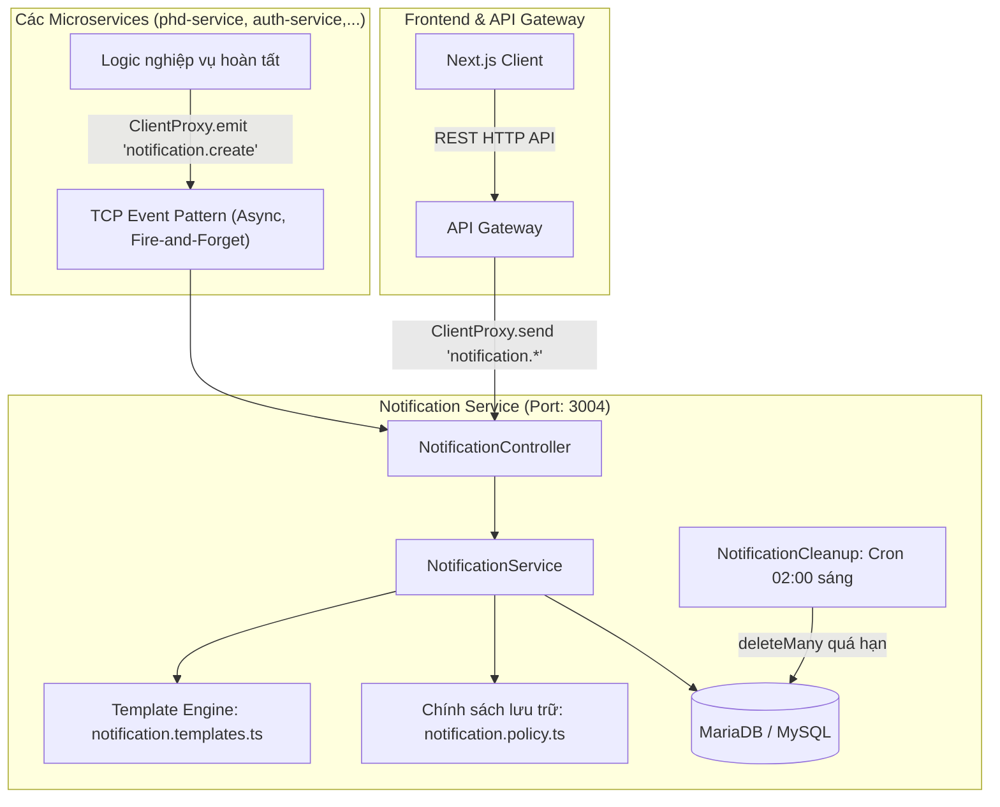

# Tài liệu Kiến trúc & Hướng dẫn Chi tiết: Notification Service

Tài liệu này giải thích toàn bộ kiến trúc, mô hình dữ liệu, cơ chế vận hành, chính sách lưu trữ và cách thức tích hợp của **Notification Service** (`backend/apps/notification-service`) trong Hệ thống Quản lý Học vụ Sau đại học.

---

## 1. Tổng quan & Vai trò Hệ thống

`notification-service` là một **Microservice độc lập** được xây dựng trên nền tảng **NestJS**, chịu trách nhiệm:
1. **Tiếp nhận và phát tán thông báo** cho người dùng (Nghiên cứu sinh, Giảng viên hướng dẫn, Giáo vụ/Admin) từ các sự kiện nghiệp vụ trong toàn hệ thống.
2. **Quản lý hộp thư thông báo cá nhân**: Danh sách thông báo, số lượng chưa đọc, đánh dấu đã đọc (từng cái hoặc tất cả).
3. **Kiểm soát vòng đời và tự động dọn dẹp (TTL & Cleanup)**: Giúp database không bị phình to theo thời gian nhưng vẫn đảm bảo tính lưu trữ pháp lý của các quyết định học vụ.
4. **Chuẩn hóa nội dung (Template-driven)**: Tách rời câu chữ hiển thị khỏi logic của các service nghiệp vụ khác.



---

## 2. Cấu trúc Thư mục

```text
backend/apps/notification-service/
├── prisma/
│   └── schema.prisma                # Schema định nghĩa bảng notification và enum NhomThongBao
├── src/
│   ├── generated/                   # Prisma Client sinh tự động
│   ├── prisma/                      # PrismaModule & PrismaService
│   ├── notification.policy.ts       # Quy tắc thời gian sống (TTL) và tính hạn tự xóa
│   ├── notification.templates.ts    # Danh mục định dạng câu chữ (tiêu đề, nội dung)
│   ├── notification-service.cleanup.ts   # Cron job dọn dẹp thông báo hết hạn
│   ├── notification-service.controller.ts # Đón nhận TCP Message & Event Patterns
│   ├── notification-service.service.ts    # Xử lý logic nghiệp vụ chính
│   ├── notification-service.module.ts     # Khởi tạo DI container và cron scheduler
│   └── main.ts                      # Điểm khởi chạy Microservice (TCP transport)
├── tsconfig.app.json
└── prisma.config.ts
```

---

## 3. Mô hình Dữ liệu (Prisma Schema)

Dữ liệu được lưu trữ trong bảng `notification`:

```prisma
enum NhomThongBao {
  QUYET_DINH          // Về quyết định (Bảo lưu, cho học tiếp, buộc thôi học, gia hạn,...)
  TIEN_DO             // Tiến độ học vụ (duyệt/từ chối mốc, phân công GVHD,...)
  NHAC_HAN            // Nhắc nhở hạn nộp, hạn học tập
  HE_THONG            // Thông báo chung từ Admin/Hệ thống
  CANH_BAO_KY_THUAT   // Cảnh báo nội bộ, lỗi kỹ thuật (dành cho Giáo vụ/Admin)
}

model Notification {
  id        String       @id @default(uuid())
  userId    String       @map("user_id")
  nhom      NhomThongBao
  loai      String       @db.VarChar(50)
  tieuDe    String       @map("tieu_de") @db.VarChar(200)
  noiDung   String       @map("noi_dung") @db.Text
  duLieu    Json?        @map("du_lieu")
  daDoc     Boolean      @default(false) @map("da_doc")
  readAt    DateTime?    @map("read_at")
  khoaTrung String?      @unique @map("khoa_trung") @db.VarChar(191)
  hetHanAt  DateTime?    @map("het_han_at")
  createdAt DateTime     @default(now()) @map("created_at")

  @@index([userId, daDoc, createdAt])
  @@index([hetHanAt])
  @@map("notification")
}
```

### Các điểm mấu chốt trong thiết kế Database:
1. **`khoaTrung` (Chống spam / Idempotency)**:
   - Khi tạo thông báo, service sẽ gán `khoaTrung = `${d.khoaTrung}:${userId}``.
   - Trường này đánh dấu `@unique`. Kết hợp với tính năng `skipDuplicates: true` của Prisma, nếu một sự kiện bị gửi lặp lại (do retry mạng, user bấm nhiều lần), hệ thống sẽ **tự động bỏ qua mà không ném lỗi**, tránh làm phiền người dùng.
2. **`hetHanAt` (Hạn tự động dọn dẹp)**:
   - Được tính toán tự động lúc tạo và cập nhật lại khi người dùng đọc thông báo.
   - Nhờ có index `[hetHanAt]`, tác vụ dọn dẹp định kỳ chạy cực nhanh mà không làm lock bảng.
3. **Compound Index `[userId, daDoc, createdAt]`**:
   - Tối ưu tuyệt đối cho truy vấn phổ biến nhất của người dùng: lấy danh sách thông báo theo từng người dùng, sắp xếp mới nhất, lọc theo trạng thái đã đọc / chưa đọc.

---

## 4. Chính sách Lưu trữ & Tính hạn Hết hạn (`notification.policy.ts`)

Thông báo không nên lưu trữ vĩnh viễn gây lãng phí tài nguyên, nhưng cũng không thể xóa quá sớm làm mất bằng chứng học vụ. Hệ thống áp dụng chính sách đa tầng:

### 4.1. Bảng quy định thời gian lưu trữ

| Nhóm thông báo (`nhom`) | Khi CHƯA ĐỌC (`chuaDocNgay`) | Khi ĐÃ ĐỌC (`sauKhiDocNgay`) | Ghi chú |
| :--- | :--- | :--- | :--- |
| **`QUYET_DINH`** | **Không bao giờ tự xóa** (`null`) | **730 ngày** (~2 năm) | Mang giá trị pháp lý học vụ cao nhất |
| **`TIEN_DO`** | **365 ngày** (1 năm) | **180 ngày** (~6 tháng) | Quá trình nộp bài, duyệt mốc nghiên cứu |
| **`NHAC_HAN`** | Tính theo hạn sự kiện | **30 ngày** (sau khi đọc) | Tối đa 30 ngày sau `ngayHan`. Nếu không có `ngayHan`: giữ 90 ngày |
| **`HE_THONG`** | **90 ngày** (hoặc `ketThucAt`) | **30 ngày** (sau khi đọc) | Thông báo bảo trì, thông báo chung |
| **`CANH_BAO_KY_THUAT`** | **30 ngày** | **14 ngày** (sau khi đọc) | Cần xử lý nhanh, hết giá trị sau xử lý |

### 4.2. Cơ chế 2 mốc tính toán:
- **`tinhHetHanKhiTao(nhom, taoLuc, duLieu)`**:
  - Tính toán ngay khi thông báo được tạo.
  - Lấy ngày sớm nhất giữa cấu hình tĩnh (`chuaDocNgay`) và mốc sự kiện (`gioiHanTheoSuKien`).
- **`tinhHetHanKhiDoc(nhom, docLuc, taoLuc, duLieu)`**:
  - Khi người dùng bấm đọc thông báo, thời hạn hết hạn được **gia hạn hoặc rút ngắn lại** theo `docLuc + sauKhiDocNgay`.
- **Ẩn tức thời (`conHan`)**:
  - Mọi query (`danhSach`, `demChuaDoc`, `danhDauDaDoc`) đều gắn điều kiện:
    ```typescript
    { OR: [{ hetHanAt: null }, { hetHanAt: { gt: new Date() } }] }
    ```
  - Nghĩa là: **Ngay khi thông báo vượt qua `hetHanAt`, người dùng sẽ không còn thấy nó nữa**, ngay cả khi tiến trình dọn dẹp database ban đêm chưa chạy.

---

## 5. Hệ thống Mẫu Thông báo (`notification.templates.ts`)

Thay vì để các service nghiệp vụ gửi chuỗi HTML hoặc câu chữ tùy ý, Notification Service định nghĩa một bộ template tập trung:

```typescript
export const MAU_THONG_BAO: Record<string, Mau> = { ... }
```

### 5.1. Danh sách các mã mẫu (`loai`):
1. **Tiến độ học vụ (`TIEN_DO`)**:
   - `MOC_DUOC_DUYET`: Báo cho NCS khi minh chứng mốc tiến độ của mình được phê duyệt (tự động thông báo mở mốc tiếp theo nếu có).
   - `MOC_BI_TU_CHOI`: Báo cho NCS lý do minh chứng của mình bị từ chối và yêu cầu nộp lại.
   - `GVHD_MOC_DUOC_DUYET`: Báo cho GVHD khi mốc tiến độ của NCS được phê duyệt (kèm tên và MSHV).
   - `GVHD_MOC_BI_TU_CHOI`: Báo cho GVHD khi mốc tiến độ của NCS bị từ chối (kèm tên, MSHV và lý do).
   - `NCS_DUOC_PHAN_CONG_GVHD`: Báo cho NCS tên giảng viên hướng dẫn vừa được chỉ định.
   - `GVHD_NHAN_NCS`: Báo cho GVHD biết họ vừa nhận hướng dẫn một NCS mới (kèm MSHV).
2. **Quyết định học vụ (`QUYET_DINH`)**:
   - `QUYET_DINH_DOI_TRANG_THAI`: Báo cho NCS khi có quyết định thay đổi trạng thái (Bảo lưu, Cho học tiếp, Buộc thôi học, Ngừng học, Gia hạn), tự động cảnh báo khóa tài khoản nếu cần.
   - `GVHD_QUYET_DINH_DOI_TRANG_THAI`: Báo cho GVHD khi có quyết định thay đổi trạng thái của NCS mình hướng dẫn (kèm tên, MSHV).
   - `QUYET_DINH_BI_HUY`: Thông báo cho NCS khi một quyết định trước đó bị hủy bỏ / thu hồi và hồ sơ được phục hồi.
   - `GVHD_QUYET_DINH_BI_HUY`: Thông báo cho GVHD khi quyết định của NCS mình hướng dẫn bị hủy bỏ / thu hồi.
3. **Cảnh báo kỹ thuật (`CANH_BAO_KY_THUAT`)**:
   - `CANH_BAO_TAI_KHOAN`: Cảnh báo khi tạo/cập nhật tài khoản đăng nhập NCS bị lỗi, cần can thiệp thủ công.
4. **Hệ thống (`HE_THONG`)**:
   - `HE_THONG_CHUNG`: Tin tức, thông báo từ ban giám hiệu hoặc quản trị viên.
5. **Nhắc hạn (`NHAC_HAN`)**:
   - `NHAC_HAN_HOC_TAP`: Đếm ngược số ngày còn lại đến hạn nộp bài/bảo vệ.

> **Cơ chế an toàn:** Nếu một service bắn sang một `loai` chưa có trong từ điển template, hệ thống sẽ ghi log cảnh báo và **từ chối lưu**, ngăn ngừa thông báo rác hoặc lỗi giao diện.

---

## 6. Giao thức Giao tiếp (Communication Patterns)

Notification Service sử dụng giao thức **NestJS TCP Transport** (Port mặc định: `3004`).

### 6.1. Nhận sự kiện tạo thông báo (Asynchronous / Event Pattern)

Các service khác bắn sự kiện qua `notification.create`. Đây là mô hình **Fire-and-forget** (gửi xong tiếp tục chạy nghiệp vụ, không cần chờ kết quả):

```typescript
// Pattern: 'notification.create'
// Payload gửi vào:
{
  userIds: string[];                 // Danh sách ID người nhận (hỗ trợ gửi hàng loạt)
  loai: string;                      // Mã template (ví dụ: 'MOC_DUOC_DUYET')
  duLieu?: Record<string, unknown>;  // Tham số điền vào template
  khoaTrung?: string;                // Khóa chống gửi trùng (ví dụ: 'DUYET_MOC:123')
}
```

*Đặc điểm:* Controller bọc `try / catch` toàn bộ. Nếu việc tạo thông báo thất bại, nó chỉ ghi log lỗi chứ tuyệt đối không làm rollback hay ném exception ra ngoài làm hỏng luồng nghiệp vụ chính của service gọi.

### 6.2. Các Message Pattern phục vụ API Gateway (Request - Response)

API Gateway gọi sang Notification Service qua cơ chế đồng bộ `send()`:

| Pattern | Input Payload | Output | Mục đích |
| :--- | :--- | :--- | :--- |
| `notification.list` | `{ userId, chiChuaDoc?, nhom?, trang?, soLuong? }` | `{ items, tong, trang, soLuong }` | Lấy danh sách thông báo phân trang của user |
| `notification.unread-count` | `{ userId }` | `{ soLuong }` | Đếm số lượng chưa đọc (để hiện badge chuông) |
| `notification.read` | `{ userId, id }` | `Notification` | Đánh dấu 1 thông báo là đã đọc (bảo mật theo `userId`) |
| `notification.read-all` | `{ userId }` | `{ soLuong }` | Đánh dấu tất cả thông báo của user thành đã đọc |

---

## 7. Tác vụ Dọn dẹp Tự động (`notification-service.cleanup.ts`)

Notification Service tích hợp `@nestjs/schedule` để chạy tác vụ ngầm:

```typescript
@Cron('0 2 * * *') // Chạy mỗi ngày vào đúng 02:00 sáng
async donDep() {
    const soDong = await this.service.xoaQuaHan();
    this.logger.log(`Đã xóa ${soDong} thông báo quá hạn lưu trữ`);
}
```

- **Logic**: Tìm các bản ghi có `hetHanAt <= new Date()` và thực hiện `deleteMany`.
- **Ưu điểm**:
  - Chạy vào khung giờ thấp điểm (2h sáng), không gây nghẽn database.
  - Xóa triệt để các bản ghi rác và giải phóng dung lượng đĩa cứng.

---

## 8. Hướng dẫn Tích hợp (Code Examples)

### 8.1. Cách một Service khác (vd: `phd-service`) bắn thông báo

Trong module của service gửi (vd: `phd.module.ts`), đăng ký client:
```typescript
ClientsModule.register([
  {
    name: 'NOTIFICATION_SERVICE',
    transport: Transport.TCP,
    options: {
      host: process.env.NOTIFICATION_SERVICE_HOST ?? '127.0.0.1',
      port: Number(process.env.NOTIFICATION_SERVICE_PORT ?? 3004),
    },
  },
])
```

Trong service nghiệp vụ (vd: khi duyệt mốc tiến độ):
```typescript
@Injectable()
export class ProgressService {
  constructor(
    @Inject('NOTIFICATION_SERVICE') private readonly notificationClient: ClientProxy,
  ) {}

  async duyetMoc(hocVienId: string, mocThuTu: number) {
    // 1. Thực hiện logic nghiệp vụ trong database...

    // 2. Bắn thông báo không đồng bộ (emit)
    this.notificationClient.emit('notification.create', {
      userIds: [hocVienId],
      loai: 'MOC_DUOC_DUYET',
      duLieu: {
        thuTu: mocThuTu,
        mocKeTiep: mocThuTu + 1,
      },
      khoaTrung: `DUYET_MOC:${hocVienId}:${mocThuTu}`,
    });
  }
}
```

### 8.2. Cách API Gateway phơi API ra cho Frontend Next.js

Trong `notification.controller.ts` của API Gateway:
```typescript
@Controller('notifications')
@UseGuards(JwtAuthGuard)
export class GatewayNotificationController {
  constructor(
    @Inject('NOTIFICATION_SERVICE') private readonly notifClient: ClientProxy,
  ) {}

  @Get()
  async getNotifications(@Req() req, @Query() query) {
    return firstValueFrom(
      this.notifClient.send('notification.list', {
        userId: req.user.id, // Lấy an toàn từ JWT Token
        chiChuaDoc: query.unread === 'true',
        nhom: query.group,
        trang: Number(query.page || 1),
        soLuong: Number(query.limit || 20),
      }),
    );
  }

  @Get('unread-count')
  async getUnreadCount(@Req() req) {
    return firstValueFrom(
      this.notifClient.send('notification.unread-count', { userId: req.user.id }),
    );
  }

  @Patch(':id/read')
  async markAsRead(@Req() req, @Param('id') id: string) {
    return firstValueFrom(
      this.notifClient.send('notification.read', { userId: req.user.id, id }),
    );
  }

  @Patch('read-all')
  async markAllAsRead(@Req() req) {
    return firstValueFrom(
      this.notifClient.send('notification.read-all', { userId: req.user.id }),
    );
  }
}
```

---

## 9. Tóm tắt Điểm Mạnh của Kiến trúc Hiện tại

1. **Hiệu năng cao & Không chặn (Non-blocking)**: Các nghiệp vụ quan trọng không bị chậm lại khi có hàng loạt người nhận thông báo vì sử dụng TCP Event async.
2. **Khả năng tự hồi phục & Ổn định**: Lỗi ở Notification Service không bao giờ kéo sập các transaction nghiệp vụ chính.
3. **Chống trùng lặp tuyệt đối**: Khóa `khoaTrung` chặn đứng việc spam thông báo do mạng chập chờn hoặc thao tác lặp lại.
4. **Quản trị vòng đời thông minh**: Cơ chế kết hợp giữa TTL ảo (`conHan()`) và Cron job vật lý (`02:00 AM`) giúp người dùng luôn thấy dữ liệu sạch ngay lập tức trong khi tài nguyên hệ thống được tối ưu định kỳ.
5. **Dễ bảo trì và mở rộng câu chữ**: Muốn thay đổi nội dung thông báo chỉ cần sửa 1 nơi duy nhất tại `notification.templates.ts` mà không phải đụng vào code các service khác.
