# BÁO CÁO MÔ TẢ CHI TIẾT HIỆN TRẠNG CHỨC NĂNG VÀ KIẾN TRÚC HỆ THỐNG BACKEND

> **Hệ thống:** Quản lý Học vụ Sau đại học — Phân hệ Quản lý Đào tạo Tiến sĩ (PAMS - Postgraduate Academic Management System)  
> **Thời điểm rà soát:** Tháng 11/2026  
> **Mục đích tài liệu:** Mô tả chính xác, toàn diện hiện trạng các dịch vụ (microservices), cơ sở dữ liệu, các luồng nghiệp vụ cốt lõi, quyền hạn và API hiện đang được triển khai thực tế trong mã nguồn Backend.

---

## 1. TỔNG QUAN KIẾN TRÚC HỆ THỐNG (SYSTEM ARCHITECTURE)

Hệ thống Backend được xây dựng hoàn toàn theo kiến trúc **Microservices** hướng Clean Architecture trên nền tảng **NestJS (v12)**, **TypeScript (ES Modules)**, cơ sở dữ liệu **MariaDB (10.11)** và lưu trữ tài liệu phân tán **SeaweedFS (S3-compatible Object Storage)**, toàn bộ triển khai bằng **Docker & Docker Compose**.

```mermaid
graph TD
    Client["Frontend (Next.js Client)"] -->|HTTP / REST API - Port 8080| Gateway["api-gateway"]
    
    Gateway -->|TCP: 3001| Auth["auth-service"]
    Gateway -->|TCP: 3002| Doc["document-service"]
    Gateway -->|TCP: 3003| Notif["notification-service"]
    Gateway -->|TCP: 3004| PhD["phd-service"]

    Auth -->|Prisma / TCP| DB_Auth[("auth_db (MariaDB)")]
    Doc -->|Prisma / TCP| DB_Doc[("document_db (MariaDB)")]
    Doc -->|AWS S3 SDK| Storage["SeaweedFS (Object Storage: 8333)"]
    Notif -->|Prisma / TCP| DB_Notif[("notification_db (MariaDB)")]
    PhD -->|Prisma / TCP| DB_PhD[("phd_db (MariaDB)")]

    PhD -.->|TCP RPC| Auth
    PhD -.->|TCP RPC| Doc
    PhD -.->|TCP RPC (NotificationClient)| Notif
```

### Các nguyên tắc kiến trúc đang áp dụng:
1. **Database-per-Service:** Mỗi microservice sở hữu một database riêng biệt (`auth_db`, `document_db`, `notification_db`, `phd_db`). Tuyệt đối không có chuyện service này truy vấn trực tiếp bảng của service khác.
2. **Giao tiếp liên dịch vụ (Inter-service Communication):** Sử dụng **NestJS Microservices TCP Transport** với message pattern dạng `{ cmd: 'domain.action' }` và payload DTO được chuẩn hóa trong thư viện chung `backend/lib/contracts`.
3. **API Gateway làm cổng trung chuyển duy nhất:** Mọi request từ phía người dùng/frontend đều đi qua `api-gateway` tại prefix `/api/v1`. Gateway chịu trách nhiệm xác thực JWT, RBAC Guard, xử lý Multipart/Upload, chuyển đổi format và timeout trước khi ủy nhiệm cho các microservice nghiệp vụ qua TCP.
4. **Pháp lý làm trung tâm (Legal Basis Driven):** Mọi sự biến động về học vụ (chuyển trạng thái NCS, giao đề tài, phân công GVHD, duyệt mốc tiến trình, xét tốt nghiệp) đều bắt buộc phải gắn với một căn cứ pháp lý là **Quyết định (QuyetDinh)** hoặc biên bản hợp lệ.
5. **Kiểm soát đồng thời (Concurrency Control):** Áp dụng **Optimistic Locking** thông qua trường `version` trong các bảng nhạy cảm (`TienTrinhNcs`, `GiangVienHuongDan`) nhằm triệt tiêu nguy cơ duyệt trùng hoặc vượt định mức khi có nhiều thao tác đồng thời.
6. **Nhật ký kiểm toán (Audit Trail):** Mọi hành động làm thay đổi dữ liệu trọng yếu đều được lưu vết `oldValue` và `newValue` trong bảng `audit_log` ngay trong cùng một Database Transaction.

---

## 2. CHI TIẾT CÁC MICROSERVICES VÀ CHỨC NĂNG HIỆN TẠI

### 2.1. API Gateway (`apps/api-gateway`)
- **Vai trò:** Cổng vào duy nhất của hệ thống Backend, lắng nghe tại cổng nội bộ 8080 (ánh xạ qua biến môi trường `API_GATEWAY_HOST_PORT`).
- **Các chức năng chính đã triển khai:**
  - **Xác thực và phân quyền:**
    - `JwtAuthGuard`: Giải mã JWT Access Token từ header `Authorization: Bearer <token>`, trích xuất thông tin người dùng (`AuthUser`).
    - `PermissionsGuard`: So khớp quyền yêu cầu tại decorator `@RequirePermissions(...)` với danh sách quyền thực tế của người dùng.
    - Public routes: Đăng nhập (`/api/v1/auth/login`), refresh token (`/api/v1/auth/refresh`), health check (`/api/v1/health`, `/api/v1/ping`).
  - **Định tuyến và Forwarding:** Chuyển tiếp request sang các microservice thông qua `ClientProxy` (RxJS `send` kèm `timeout`).
  - **Xử lý tệp tin (File Handling):** Tiếp nhận upload file PDF minh chứng, đơn từ và chuyển thành base64 gửi sang `document-service`; tiếp nhận file Excel `.xlsx` để xử lý import NCS/GVHD (kiểm tra MIME type và giới hạn kích thước).

---

### 2.2. Auth Service (`apps/auth-service`)
- **Vai trò:** Quản lý danh tính (Identity), xác thực người dùng (Authentication), phân quyền theo vai trò (RBAC), quản lý phiên đăng nhập (Session/Token).
- **Cơ sở dữ liệu:** `auth_db`.
- **Mô hình dữ liệu:**
  - `User`: Lưu tài khoản đăng nhập (mã số/MSHV/mã GV làm `username`), mật khẩu băm bcrypt, họ tên, email, trạng thái khóa `isActive`, cờ bắt buộc đổi mật khẩu `mustChangePassword`.
  - `Role`: Danh mục vai trò (`ADMIN`, `GIAO_VU`, `GVHD`, `NCS`).
  - `Permission`: Danh mục quyền chi tiết (fine-grained permissions).
  - `UserRole`, `RolePermission`: Các bảng liên kết nhiều-nhiều.
  - `RefreshToken`: Quản lý refresh token (lưu chuỗi hash SHA-256), thời hạn hết hạn, cờ thu hồi `revokedAt`.
- **Các chức năng đã hiện thực:**
  1. **Đăng nhập (`auth.login`):** Kiểm tra username, so khớp mật khẩu bcrypt. Nếu tài khoản bị khóa (`isActive = false`), từ chối đăng nhập. Trả về cặp Access Token (ngắn hạn) và Refresh Token (dài hạn).
  2. **Cơ chế Token Rotation & Reuse Detection:** Khi gọi refresh token, token cũ bị thu hồi và phát hành token mới. Nếu một token đã thu hồi bị sử dụng lại (nghi vấn bị đánh cắp), hệ thống lập tức thu hồi toàn bộ phiên đăng nhập của người dùng đó. Có áp dụng cơ chế Grace Period Cache (15 giây) để tránh race condition khi nhiều request refresh đồng thời từ frontend.
  3. **Đăng xuất (`auth.logout`):** Thu hồi refresh token hiện tại.
  4. **Đổi mật khẩu (`auth.change-password`):** Người dùng tự đổi mật khẩu, xác thực mật khẩu cũ và tắt cờ `mustChangePassword`.
  5. **Quản trị người dùng (Dành cho Giáo vụ/Admin):**
     - Tạo người dùng thủ công hoặc hàng loạt.
     - Khóa / Mở khóa tài khoản người dùng (`auth.update-user-status`).
     - Reset mật khẩu về mặc định (`auth.reset-password`).
     - Lấy danh sách người dùng kèm phân trang, tìm kiếm theo họ tên, username, vai trò.
  6. **Auth Cron Service:** Định kỳ dọn dẹp các refresh token đã hết hạn hoặc đã bị thu hồi trong database.

---

### 2.3. Document Service (`apps/document-service`)
- **Vai trò:** Quản lý metadata và lưu trữ an toàn các tệp tài liệu PDF, tích hợp lưu trữ đối tượng SeaweedFS (S3 API).
- **Cơ sở dữ liệu:** `document_db`.
- **Mô hình dữ liệu:**
  - `Document`: Lưu metadata tệp bao gồm `ownerId`, `ncsId`, `documentType`, `refType`, `refId`, `bucket`, `objectKey`, `originalName`, `mimeType`, `size`, `checksum` (SHA-256), `status` (`PENDING`, `ACTIVE`, `DELETED`), thời điểm xóa mềm `deletedAt`.
- **Quy định & Ràng buộc tài liệu:**
  - **Định dạng:** Chỉ chấp nhận duy nhất tệp có đuôi `.pdf` và kiểm tra 5 bytes đầu tiên của file phải đúng chữ ký chuẩn `%PDF-` (chặn triệt để việc cố tình đổi đuôi file).
  - **Dung lượng:** Giới hạn tối đa **15MB** (`MAX_PDF_SIZE = 15 * 1024 * 1024 bytes`).
  - **Toàn vẹn dữ liệu:** Tự động tính mã băm SHA-256 (`checksum`) ngay khi nhận tệp.
  - **Phân loại tài liệu (`DocumentType`):**
    - `MINH_CHUNG_MOC`: Minh chứng các mốc tiến trình của NCS.
    - `QUYET_DINH`: Tệp scan quyết định pháp lý.
    - `MINH_CHUNG_NGOAI_NGU`: Minh chứng đạt chuẩn đầu ra ngoại ngữ.
    - `MINH_CHUNG_CONG_NO`: Minh chứng hoàn thành công nợ/học phí.
    - `DON_TU`: Đơn đề nghị điều chỉnh đề tài, GVHD, gia hạn học tập.
    - `BIEU_MAU`: Các biểu mẫu học vụ chuẩn.
    - `QUY_DINH`: Văn bản quy định đào tạo.
    - `KHAC`: Các tài liệu khác.
- **Quy tắc phân quyền truy cập tài liệu:**
  - NCS chỉ được tải lên loại `MINH_CHUNG_MOC` và `DON_TU`, và tệp luôn gắn chặt vào hồ sơ NCS của chính mình.
  - NCS chỉ có quyền đọc/tải xuống những tệp do chính mình sở hữu hoặc các quyết định liên quan trực tiếp đến hồ sơ của mình.
  - Giáo vụ và Quản trị viên có toàn quyền truy xuất tài liệu phục vụ công tác xét duyệt.
  - Hỗ trợ xóa mềm (`DELETED`) và download tệp dưới dạng Stream.

---

### 2.4. Notification Service (`apps/notification-service`)
- **Vai trò:** Trung tâm quản lý thông báo nội bộ (In-app Notification) cho toàn bộ các tác vụ trong hệ thống.
- **Cơ sở dữ liệu:** `notification_db`.
- **Mô hình dữ liệu:**
  - `Notification`: Lưu `userId`, `nhom`, `loai`, `tieuDe`, `noiDung`, `duLieu` (JSON), `daDoc`, `readAt`, `khoaTrung` (Unique constraint), `hetHanAt`.
- **Các nhóm thông báo (`NhomThongBao`):**
  - `QUYET_DINH`: Thông báo liên quan đến việc ban hành hoặc vô hiệu hóa quyết định.
  - `TIEN_DO`: Thông báo biến động tiến độ (NCS nộp minh chứng, Giáo vụ duyệt/từ chối mốc, giao đề tài, phân công GVHD, kết quả đơn đề nghị).
  - `NHAC_HAN`: Thông báo nhắc nhở hạn học vụ (nhắc mốc sắp đến hạn 30/15/7 ngày, nhắc nộp báo cáo định kỳ 6 tháng).
  - `HE_THONG`: Thông báo diện rộng từ Admin.
  - `CANH_BAO_KY_THUAT`: Cảnh báo nguy cơ quá hạn đào tạo 72 tháng.
- **Cơ chế đặc thù đã hoàn thiện:**
  - **Chống spam / Gửi trùng lặp (`khoaTrung`):** Sử dụng khóa duy nhất (kết hợp nghiệp vụ + userId). Khi gửi trùng khóa trong cùng chu kỳ, database tự động bỏ qua (`skipDuplicates: true`).
  - **Tự động tính hạn hết hạn (`hetHanAt`):** Tính toán vòng đời của thông báo dựa theo loại và nghiệp vụ.
  - **Tự động ẩn thông báo quá hạn:** Mọi câu truy vấn danh sách thông báo và đếm số lượng chưa đọc đều lọc điều kiện thông báo còn hạn (`hetHanAt == null OR hetHanAt > NOW()`).
  - Đánh dấu đã đọc từng thông báo hoặc toàn bộ thông báo.

---

### 2.5. PhD Service (`apps/phd-service`) — Dịch vụ Nghiệp vụ Trung tâm
Đây là trái tim của hệ thống, quản lý toàn bộ vòng đời đào tạo của Nghiên cứu sinh, bao gồm 10 phân hệ nghiệp vụ chính:

#### (1) Quản lý Hồ sơ Nghiên cứu sinh (NCS Management)
- **Dữ liệu quản lý:** MSHV, họ tên, ngày sinh, giới tính, CCCD (lưu chuỗi chuẩn hóa), email, số điện thoại, ngành đào tạo, khóa tuyển sinh (liên kết danh mục `KhoaHocNcs`), lớp, ngày nhập học, trình độ đầu vào (`THAC_SI` / `DAI_HOC`), phương thức đào tạo (`PHUONG_THUC_1` / `PHUONG_THUC_2`).
- **Thời hạn đào tạo tính toán tự động:**
  - Hạn chính quy (`hanChinhQuy`): 3 năm (đối với đầu vào Thạc sĩ) hoặc 4 năm (đối với đầu vào Đại học) tính từ ngày nhập học.
  - Hạn tối đa buộc thôi học (`hanBuocThoiHoc`): 72 tháng (6 năm) kể từ ngày nhập học (theo Quy chế đào tạo Tiến sĩ).
  - Hạn gia hạn (`hanGiaHan`): Cập nhật khi có quyết định gia hạn, không được vượt quá `hanBuocThoiHoc`.
- **Trạng thái học tập (`TrangThaiHocTap`):** `DANG_HOC`, `DA_TOT_NGHIEP`, `GIA_HAN`, `BUOC_THOI_HOC`, `BAO_LUU`, `NGUNG_HOC`.
- **Cơ chế Import danh sách NCS từ Excel (`ncs-import.service.ts`):**
  - Cung cấp API tải template mẫu `.xlsx`.
  - Quy trình 2 bước an toàn:
    - **Bước 1 (Preview):** Đọc file Excel, kiểm tra định dạng CCCD, SĐT, Email, ngày tháng, kiểm tra trùng lặp trong file và database, kiểm tra danh mục ngành/khóa. Trả về chi tiết từng dòng hợp lệ hoặc lỗi.
    - **Bước 2 (Confirm):** Thực hiện trong một Transaction: Tạo hồ sơ NCS, tự động khởi tạo tài khoản đăng nhập bên `auth-service` (mật khẩu mặc định bằng CCCD/ngày sinh và gắn role `NCS`), đồng thời tự động khởi tạo 9 mốc tiến trình cho NCS.
- **Ràng buộc quan trọng:** Không cho phép cập nhật trạng thái học tập của NCS một cách tùy tiện bằng API PATCH thông thường. Mọi sự chuyển đổi trạng thái học tập (Bảo lưu, Ngừng học, Buộc thôi học, Gia hạn, Học tiếp) bắt buộc phải thông qua việc tạo **Quyết định (QuyetDinh)** pháp lý tương ứng.

#### (2) Quản lý Giảng viên Hướng dẫn & Kiểm soát Định mức (Supervisors & Quota)
- **Dữ liệu giảng viên:** Mã GV/SHCC, họ tên, học hàm học vị (`GIAO_SU`, `PHO_GIAO_SU`, `TIEN_SI_KHOA_HOC`, `TIEN_SI`), chuyên ngành, quốc gia tốt nghiệp tiến sĩ, đơn vị công tác (liên kết cây tổ chức `DonVi`: Khoa, Bộ môn, Phòng ban), lịch sử công bố khoa học 5 năm (JSON).
- **Kiểm soát định mức hướng dẫn (Rule BR-09):**
  - Định mức tối đa (`maxNcsChoPhep`):
    - **Giáo sư:** Hướng dẫn tối đa **7** NCS.
    - **Phó Giáo sư:** Hướng dẫn tối đa **5** NCS.
    - **Tiến sĩ / Tiến sĩ khoa học:** Hướng dẫn tối đa **3** NCS.
  - Quy đổi trọng số hướng dẫn (`trongSo`):
    - Hướng dẫn độc lập / Hướng dẫn chính: tính **1.0** NCS.
    - Đồng hướng dẫn: tính **0.5** NCS.
  - Hệ thống tự động cache số lượng NCS đang hướng dẫn (`soNcsDangHuongDan`).
  - Sử dụng Optimistic Lock (`version`) khi phân công GVHD để ngăn chặn 2 tác vụ đồng thời làm vượt quá hạn ngạch cho phép.
- **Cơ chế Import danh sách GVHD từ Excel:** Hỗ trợ quy trình Preview & Confirm tương tự như NCS, tự động tạo tài khoản đăng nhập với role `GVHD`.

#### (3) Quản lý Phân công Hướng dẫn (Supervisor Assignment)
- Liên kết giữa NCS và GVHD theo vai trò (`HUONG_DAN_CHINH`, `DONG_HUONG_DAN`).
- **Điều kiện bắt buộc:** Phải gắn liền với một Quyết định có loại `PHAN_CONG_GVHD` đang có hiệu lực.
- Khi tạo phân công, hệ thống kiểm tra định mức của GVHD (nếu vượt quá sẽ ném ngoại lệ chặn lại) và tự động tăng số lượng hướng dẫn của giảng viên.
- Khi phân công bị chấm dứt hoặc thay thế, hệ thống cập nhật trạng thái `DEACTIVATE`, ghi nhận `ngayKetThuc` và giảm trừ định mức của GVHD tương ứng.

#### (4) Quản lý Đề tài Luận án (Thesis Topic Management)
- Quản lý tên đề tài nghiên cứu chính thức của từng NCS.
- Giao đề tài bắt buộc phải có Quyết định loại `GIAO_DE_TAI`.
- Đảm bảo mỗi NCS tại một thời điểm chỉ có duy nhất **01 đề tài ở trạng thái `HIEU_LUC`**.
- Khi NCS có đơn đổi đề tài được duyệt, đề tài cũ được chuyển sang `DA_THAY_THE` và đề tài mới được kích hoạt gắn với quyết định mới.

#### (5) Tiến trình Đào tạo 9 Mốc (9 Milestones & Evidence Review Workflow)
Hệ thống quản lý 9 mốc nghiệp vụ đào tạo bám sát lộ trình chuẩn:

| Thứ tự | Tên mốc | Yêu cầu chấm điểm | Quy tắc & Hạn quy định |
| :---: | :--- | :---: | :--- |
| **1** | **Nhập học** | Không | Tự động hoàn thành (`PASSED`) ngay khi khởi tạo hồ sơ NCS. |
| **2** | **Tiểu luận tổng quan** | **Có** | Hoàn thành trong 06 tháng đầu khóa; cần tối thiểu 3 phiếu nhận xét, điểm TB >= 7.0. |
| **3** | **Đề cương chi tiết** | Không | Hoàn thành trong 06 tháng đầu khóa. |
| **4** | **Chuyên đề 1** | **Có** | Đăng ký đầu năm 2; hoàn thành trước mốc 8; tối thiểu 3 phiếu nhận xét, điểm TB >= 7.0. |
| **5** | **Chuyên đề 2** | **Có** | Hoàn thành trước mốc 8; tối thiểu 3 phiếu nhận xét, điểm TB >= 7.0. |
| **6** | **Bảo vệ giữa kỳ** | Không | Báo cáo tiến độ định kỳ 6 tháng một lần (đợt cố định vào tháng 6 và tháng 12 hàng năm). |
| **7** | **Seminar cuối khóa** | Không | Hoàn thành trước khi nộp hồ sơ mốc 8. |
| **8** | **Bảo vệ cấp Bộ môn** | Không | Nộp hồ sơ chậm nhất 03 tháng trước khi hết hạn chính quy. |
| **9** | **Bảo vệ cấp Trường & Phản biện kín** | Không | Hoàn thiện gửi phản biện tối đa 60 ngày làm việc sau mốc 8; bảo vệ cấp cơ sở trong vòng 12 tháng từ khi đạt mốc 8. |

- **Nguyên tắc mở khóa tuần tự (Sequential Unlocking):**
  - Mốc 1 tự động `PASSED`.
  - Mốc 2 được mở khóa (`UNLOCKED`) sẵn sàng cho NCS nộp bài.
  - Các mốc từ 3 đến 9 ban đầu ở trạng thái khóa (`LOCKED`).
  - NCS **chỉ có thể nộp minh chứng** cho mốc kế tiếp khi mốc liền trước đó đã được Giáo vụ phê duyệt đạt (`PASSED`).
- **Vòng đời trạng thái mốc (`TrangThaiMoc`):**
  `LOCKED` ➔ `UNLOCKED` ➔ `PENDING_REVIEW` ➔ `PASSED` (hoặc `REJECTED` ➔ NCS nộp lại chuyển về `PENDING_REVIEW`).
- **Quy trình Nộp và Xét duyệt Minh chứng:**
  1. NCS tải file PDF lên hệ thống lưu trữ, sau đó gọi lệnh nộp minh chứng cho mốc hợp lệ.
  2. Mỗi lần nộp được lưu thành 1 bản ghi `MinhChungMoc` với số lần nộp tự tăng (`lanNop`). Nếu bị từ chối, bản ghi cũ giữ nguyên lịch sử, lần nộp sau sẽ là `lanNop + 1`.
  3. Đối với các mốc có chấm điểm (Mốc 2, 4, 5): Giáo vụ nhập các phiếu chấm (`PhieuNhanXet`) từ hội đồng/chuyên gia bên ngoài vào hệ thống. Hệ thống kiểm tra: **phải đủ tối thiểu 3 phiếu nhận xét** và **điểm trung bình cộng phải >= 7.0 điểm** thì mới cho phép bấm duyệt đạt.
  4. Khi duyệt đạt: Giáo vụ bắt buộc phải chọn Quyết định căn cứ pháp lý (`CAN_CU_DUYET_MOC`). Hệ thống trong một transaction sẽ:
     - Chuyển trạng thái mốc hiện tại sang `PASSED` và lưu `passedAt`.
     - Tự động mở khóa mốc tiếp theo sang `UNLOCKED` và lưu `openedAt`.
     - Tự động ghi nhận `AuditLog`.
     - Bắn thông báo nội bộ tới NCS và GVHD.
  5. Khi từ chối: Giáo vụ bắt buộc nhập lý do từ chối (`lyDoTuChoi`). Trạng thái mốc chuyển thành `REJECTED`. NCS nhận thông báo và có thể nộp bổ sung/thay thế minh chứng mới.

#### (6) Hệ thống Quản lý Thời hạn Thông minh (`DeadlineService`)
- Hạn của từng mốc cho từng NCS không lưu chết mà được tính toán động (dynamically computed) dựa trên các cấu hình quy định tại bảng `moc_han`:
  - `NGAY_NHAP_HOC`: Tính cộng thêm số tháng từ ngày nhập học của NCS.
  - `NGAY_MOC_DAT`: Tính cộng thêm ngày làm việc hoặc tháng kể từ ngày mốc gốc tương ứng đạt `PASSED`.
  - `HET_HAN_CHINH_QUY`: Lùi lại số tháng quy định trước hạn kết thúc khóa học chính quy.
- Hỗ trợ thêm trường `hanKeHoach`: Giáo vụ có thể nhập hạn kế hoạch cá nhân hóa cho từng NCS theo kế hoạch nghiên cứu toàn khóa được duyệt.
- Trả về chi tiết tình trạng cho Frontend: `CON_HAN`, `SAP_DEN_HAN`, `QUA_HAN`, `DA_DAT` cùng số ngày còn lại.

#### (7) Hệ thống Quyết định Pháp lý (`DecisionService`)
- Là nền tảng pháp lý của toàn bộ hoạt động học vụ:
  - Các loại quyết định: `GIAO_DE_TAI`, `PHAN_CONG_GVHD`, `THANH_LAP_TIEU_BAN`, `CAN_CU_DUYET_MOC`, `CONG_NHAN_TOT_NGHIEP`, `GIA_HAN`, `BAO_LUU`, `NGUNG_HOC`, `BUOC_THOI_HOC`, `HOC_TIEP`, `KHAC`.
- **Tác động trực tiếp đến trạng thái tài khoản người dùng:**
  - Khi ban hành quyết định `BAO_LUU`, `NGUNG_HOC`, `BUOC_THOI_HOC`: Hệ thống tự động chuyển trạng thái học tập của NCS đồng thời gọi sang `auth-service` để **khóa tài khoản đăng nhập** của NCS đó.
  - Khi ban hành quyết định `HOC_TIEP`: Hệ thống chuyển trạng thái NCS về lại `DANG_HOC` và tự động **mở khóa tài khoản**.
- **Cơ chế Hoàn tác an toàn (Deactivate Decision):**
  - Cho phép Giáo vụ hủy hiệu lực của một quyết định.
  - Hệ thống kiểm tra xem NCS đã có quyết định mới hơn làm thay đổi trạng thái hay chưa. Nếu là quyết định mới nhất, hệ thống tự động đọc lại `oldValue` từ `audit_log` để phục hồi chính xác trạng thái học tập, hạn đào tạo ban đầu của NCS và mở/khóa lại tài khoản đồng bộ.

#### (8) Quản lý Đề nghị Điều chỉnh Học vụ (`ChangeRequestService`)
Hỗ trợ 3 nhóm đề nghị trực tuyến:
1. `DOI_DE_TAI`: Đề nghị đổi tên đề tài nghiên cứu (yêu cầu tên đề tài mới, lý do, đính kèm đơn).
2. `DOI_GVHD`: Đề nghị thay đổi giảng viên hướng dẫn (chọn phân công cũ cần hủy, chọn GVHD mới, kiểm tra hạn ngạch của GVHD mới).
3. `GIA_HAN`: Đăng ký gia hạn thời gian đào tạo:
   - NCS bắt buộc phải đính kèm báo cáo tiến độ/minh chứng.
   - Chỉ được xin gia hạn khi tổng thời gian đào tạo sau khi gia hạn không vượt quá thời hạn tối đa 72 tháng (`hanBuocThoiHoc`).
   - **Quy trình xét duyệt 2 cấp (Multi-step approval):**
     - **Cấp 1 - Giảng viên hướng dẫn xác nhận:** Hệ thống tự động tạo các bản ghi `XacNhanGvhdDeNghi` cho từng GVHD trong tập thể hướng dẫn. Trạng thái ban đầu là `CHO_GVHD_XAC_NHAN`. Tất cả các GVHD phải vào hệ thống bấm Đồng ý thì đơn mới được chuyển lên cho Giáo vụ (`CHO_DUYET`). Nếu bất kỳ GVHD nào từ chối, đơn lập tức bị chuyển thành `TU_CHOI`.
     - **Cấp 2 - Giáo vụ phê duyệt:** Giáo vụ kiểm tra, khi bấm duyệt bắt buộc phải đính kèm số và ngày Quyết định gia hạn của Hiệu trưởng.
   - Khi được duyệt: Toàn bộ việc cập nhật hạn gia hạn của NCS (`hanGiaHan`), đổi trạng thái NCS sang `GIA_HAN`, tạo quyết định và ghi audit log được thực thi trọn vẹn trong **01 Database Transaction**.

#### (9) Xét Tốt nghiệp Tự động (`GraduationAssessmentService`)
Phục vụ xét hoàn tất khóa học và công nhận học vị Tiến sĩ:
- **Tự động kiểm tra các điều kiện cứng:**
  - Toàn bộ 9 mốc tiến trình của NCS bắt buộc phải đạt `PASSED`.
  - Không còn bất kỳ đơn đề nghị điều chỉnh nào đang nằm ở trạng thái chờ duyệt (`CHO_DUYET` / `CHO_GVHD_XAC_NHAN`).
  - Chưa vượt quá hạn đào tạo tối đa (72 tháng).
- **Kiểm tra 2 điều kiện học vụ bổ sung có minh chứng:**
  - **Chuẩn đầu ra Ngoại ngữ:** Giáo vụ xác nhận cờ `datNgoaiNgu`, chuẩn ngoại ngữ đạt được, ngày công nhận, ghi chú và bắt buộc liên kết tệp PDF chứng chỉ ngoại ngữ (`ngoaiNguDocumentId`).
  - **Nghĩa vụ Tài chính / Công nợ:** Giáo vụ xác nhận cờ `khongConCongNo`, ngày xác nhận, ghi chú và tệp PDF xác nhận không nợ học phí từ phòng kế toán (`congNoDocumentId`).
- **Phê duyệt Tốt nghiệp:**
  - Khi đã thỏa mãn đầy đủ các điều kiện trên, hệ thống đánh dấu trạng thái `DU_DIEU_KIEN`.
  - Giáo vụ tiến hành bấm Phê duyệt tốt nghiệp (`Post /confirm`), yêu cầu gắn Quyết định công nhận tốt nghiệp (`CONG_NHAN_TOT_NGHIEP`).
  - Hệ thống cập nhật trạng thái tốt nghiệp sang `DA_DUYET`, cập nhật trạng thái học tập của NCS thành `DA_TOT_NGHIEP`, lưu `ngayTotNghiep` chính thức và ghi vết audit log.

#### (10) Nhật ký Kiểm toán & Hệ thống Cron Jobs định kỳ
- **Audit Service (`audit.service.ts`):**
  - Cung cấp API tra cứu toàn bộ lịch sử biến động trong hệ thống dành cho Admin và Giáo vụ.
  - Cho phép lọc theo hành động (`action`), đối tượng (`entityType`), mã bản ghi (`entityId`), người thực hiện (`actorId`), mã NCS (`ncsId`), khoảng thời gian (`fromDate`, `toDate`) và từ khóa tìm kiếm.
  - Tự động làm giàu dữ liệu (enrichment): Đính kèm họ tên, email của người thực hiện và thông tin chi tiết của NCS vào từng bản ghi audit.
- **PhD Cron Service (`phd-cron.service.ts`):**
  - **`DeadlineReminderCron` (Chạy 06:00 sáng mỗi ngày):** Quét toàn bộ các mốc của các NCS đang học. Nếu mốc còn đúng 30 ngày, 15 ngày hoặc 7 ngày là đến hạn, tự động gửi thông báo nhắc nhở `NHAC_HAN_HOC_TAP` cho cả NCS và GVHD.
  - **`PeriodicReportCron` (Chạy 06:00 sáng ngày 01/06 và 01/12 hàng năm):** Nhắc nhở kỳ báo cáo tiến độ 6 tháng định kỳ (Mốc 6), tính toán hạn nộp (30/06 hoặc 31/12) và gửi thông báo nhắc hạn đến NCS và GVHD.
  - **`TrainingLimitCron` (Chạy 06:00 sáng thứ Hai hàng tuần):** Quét các NCS có thời gian học tập còn lại đến ngưỡng tối đa 72 tháng (`hanBuocThoiHoc`) dưới 6 tháng (<= 180 ngày). Tự động phát cảnh báo đỏ `CANH_BAO_HET_HAN_DAO_TAO` gửi đồng thời cho NCS, GVHD và Giáo vụ.

---

## 3. SƠ ĐỒ VÀ ĐẶC TẢ USE CASE HỆ THỐNG (SYSTEM USE CASES)

### 3.1. Sơ đồ Use Case Tổng quan (Use Case Diagram)

```mermaid
flowchart TD
    subgraph Actors["Tác nhân (Actors)"]
        NCS["Nghiên cứu sinh (NCS)"]
        GVHD["Giảng viên hướng dẫn (GVHD)"]
        GV["Giáo vụ SĐH (GIAO_VU)"]
        ADMIN["Quản trị viên (ADMIN)"]
        CRON["Hệ thống Cron Tự động"]
    end

    subgraph UC_Auth["1. Quản trị & Xác thực"]
        UC01["UC-01: Đăng nhập & Quản lý phiên (JWT)"]
        UC02["UC-02: Đổi mật khẩu / Reset mật khẩu"]
        UC03["UC-03: Quản lý người dùng & Khóa tài khoản"]
        UC04["UC-04: Tra cứu Nhật ký kiểm toán (Audit Log)"]
    end

    subgraph UC_Profile["2. Quản lý Hồ sơ & Danh mục"]
        UC05["UC-05: Import NCS từ Excel (Preview & Confirm)"]
        UC06["UC-06: Import GVHD từ Excel (Preview & Confirm)"]
        UC07["UC-07: Xem & Cập nhật Hồ sơ cá nhân / NCS"]
    end

    subgraph UC_Assignment["3. Phân công & Đề tài"]
        UC08["UC-08: Giao đề tài luận án chính thức"]
        UC09["UC-09: Phân công GVHD & Kiểm soát định mức (BR-09)"]
        UC10["UC-10: Vô hiệu hóa phân công / Đổi đề tài"]
    end

    subgraph UC_Progress["4. Tiến trình 9 Mốc & Minh chứng"]
        UC11["UC-11: Xem tiến trình 9 mốc & Deadline thông minh"]
        UC12["UC-12: Nộp minh chứng mốc (PDF <= 15MB)"]
        UC13["UC-13: Nhập phiếu nhận xét online & Chấm điểm (Mốc 2,4,5)"]
        UC14["UC-14: Phê duyệt mốc (kèm Quyết định) & Mở khóa mốc kế tiếp"]
        UC15["UC-15: Từ chối mốc & Yêu cầu nộp lại"]
        UC16["UC-16: Cập nhật hạn kế hoạch nghiên cứu cá nhân"]
    end

    subgraph UC_ChangeRequest["5. Đề nghị Điều chỉnh Học vụ"]
        UC17["UC-17: Nộp đơn xin đổi đề tài / đổi GVHD"]
        UC18["UC-18: Nộp đơn xin gia hạn học tập (kèm báo cáo)"]
        UC19["UC-19: Tập thể GVHD xác nhận đơn gia hạn (Cấp 1)"]
        UC20["UC-20: Giáo vụ phê duyệt đơn điều chỉnh (Cấp 2)"]
        UC21["UC-21: Hủy đơn đề nghị đang chờ duyệt"]
    end

    subgraph UC_Decision["6. Quyết định Pháp lý"]
        UC22["UC-22: Ban hành Quyết định học vụ"]
        UC23["UC-23: Vô hiệu hóa Quyết định & Hoàn tác trạng thái"]
    end

    subgraph UC_Graduation["7. Xét Tốt nghiệp & Hoàn tất"]
        UC24["UC-24: Tự động kiểm tra điều kiện tốt nghiệp"]
        UC25["UC-25: Xác nhận chuẩn Ngoại ngữ đầu ra (kèm PDF)"]
        UC26["UC-26: Xác nhận hoàn thành Công nợ/Học phí (kèm PDF)"]
        UC27["UC-27: Phê duyệt Công nhận tốt nghiệp & Cấp bằng"]
    end

    subgraph UC_Notification["8. Thông báo & Tự động hóa"]
        UC28["UC-28: Xem & Đánh dấu đã đọc thông báo"]
        UC29["UC-29: Tự động quét hạn mốc & Nhắc nhở (30/15/7 ngày)"]
        UC30["UC-30: Nhắc nộp báo cáo định kỳ 6 tháng (Mốc 6)"]
        UC31["UC-31: Cảnh báo đỏ nguy cơ quá hạn 72 tháng"]
    end

    %% Kết nối Actor -> Use Case
    NCS --> UC01 & UC02 & UC07 & UC11 & UC12 & UC17 & UC18 & UC21 & UC28
    GVHD --> UC01 & UC02 & UC07 & UC11 & UC19 & UC28
    GV --> UC01 & UC02 & UC03 & UC04 & UC05 & UC06 & UC07 & UC08 & UC09 & UC10 & UC11 & UC13 & UC14 & UC15 & UC16 & UC20 & UC22 & UC23 & UC24 & UC25 & UC26 & UC27 & UC28
    ADMIN --> UC01 & UC02 & UC03 & UC04 & UC28
    CRON --> UC29 & UC30 & UC31
```



---

### 3.2. Danh mục Toàn bộ Use Cases Hệ thống

| Mã UC | Tên Use Case | Tác nhân chính (Actor) | Tác nhân phụ | Service phụ trách | Endpoint API tương ứng |
| :---: | :--- | :--- | :--- | :--- | :--- |
| **UC-01** | Đăng nhập & Quản lý phiên | Tất cả | — | `auth-service` | `POST /auth/login`, `POST /auth/refresh`, `POST /auth/logout` |
| **UC-02** | Đổi & Reset mật khẩu | Tất cả | Giáo vụ / Admin | `auth-service` | `POST /auth/change-password`, `PATCH /auth/users/:id/reset-password` |
| **UC-03** | Quản lý người dùng & Khóa tài khoản | Giáo vụ, Admin | — | `auth-service` | `GET/POST /auth/users`, `PATCH /auth/users/:id/status` |
| **UC-04** | Tra cứu Nhật ký kiểm toán | Giáo vụ, Admin | — | `phd-service` | `GET /audit-logs`, `GET /audit-logs/:id` |
| **UC-05** | Import NCS từ Excel | Giáo vụ, Admin | `auth-service` | `phd-service` | `POST /ncs/import/preview`, `POST /ncs/import/confirm` |
| **UC-06** | Import GVHD từ Excel | Giáo vụ, Admin | `auth-service` | `phd-service` | `POST /gvhd/import/preview`, `POST /gvhd/import/confirm` |
| **UC-07** | Xem & Cập nhật Hồ sơ | Tất cả | — | `phd-service` | `GET /ncs/me`, `GET /ncs/:id`, `PATCH /ncs/:id`, `GET /gvhd/me` |
| **UC-08** | Giao đề tài luận án chính thức | Giáo vụ | NCS, GVHD | `phd-service` | `POST /thesis`, `GET /thesis/ncs/me` |
| **UC-09** | Phân công GVHD & Quản lý định mức | Giáo vụ | GVHD, NCS | `phd-service` | `POST /gvhd/assignments`, `GET /gvhd/assignments` |
| **UC-10** | Hủy phân công GVHD / Đề tài | Giáo vụ | GVHD, NCS | `phd-service` | `PATCH /gvhd/assignments/:id/deactivate`, `PATCH /thesis/:id/deactivate` |
| **UC-11** | Xem tiến trình 9 mốc & Thời hạn | NCS, GVHD, Giáo vụ | — | `phd-service` | `GET /progress/me`, `GET /progress/ncs/:ncsId` |
| **UC-12** | Nộp minh chứng mốc (PDF) | NCS | Giáo vụ | `phd-service`, `document-service` | `POST /progress/milestones/:thuTu/submit` |
| **UC-13** | Nhập phiếu nhận xét online & Điểm | Giáo vụ | Hội đồng | `phd-service` | `POST /progress/evidences/:minhChungId/evaluations` |
| **UC-14** | Phê duyệt mốc & Mở khóa mốc kế | Giáo vụ | NCS, GVHD | `phd-service` | `POST /progress/reviews/:tienTrinhId/approve` |
| **UC-15** | Từ chối mốc & Yêu cầu nộp lại | Giáo vụ | NCS | `phd-service` | `POST /progress/reviews/:tienTrinhId/reject` |
| **UC-16** | Cập nhật hạn kế hoạch nghiên cứu | Giáo vụ | NCS | `phd-service` | `PATCH /progress/milestones/:tienTrinhId/plan-deadline` |
| **UC-17** | Nộp đơn đổi đề tài / đổi GVHD | NCS | GVHD, Giáo vụ | `phd-service`, `document-service` | `POST /change-request` |
| **UC-18** | Nộp đơn xin gia hạn học tập | NCS | GVHD, Giáo vụ | `phd-service`, `document-service` | `POST /change-request` (loại `GIA_HAN`) |
| **UC-19** | GVHD xác nhận đơn gia hạn (Cấp 1) | GVHD | NCS, Giáo vụ | `phd-service` | `PATCH /change-request/:id/supervisor-review` |
| **UC-20** | Giáo vụ phê duyệt đơn điều chỉnh (Cấp 2) | Giáo vụ | NCS, GVHD | `phd-service` | `PATCH /change-request/:id/approve`, `PATCH /change-request/:id/reject` |
| **UC-21** | Hủy đơn đề nghị điều chỉnh | NCS | Giáo vụ | `phd-service` | `PATCH /change-request/:id/cancel` |
| **UC-22** | Ban hành Quyết định pháp lý | Giáo vụ | NCS | `phd-service`, `document-service` | `POST /decisions`, `GET /decisions` |
| **UC-23** | Vô hiệu hóa QĐ & Hoàn tác trạng thái | Giáo vụ | NCS, Auth | `phd-service`, `auth-service` | `PATCH /decisions/:id/deactivate` |
| **UC-24** | Kiểm tra tự động điều kiện tốt nghiệp | Giáo vụ, NCS | — | `phd-service` | `GET /graduation`, `GET /graduation/ncs/:ncsId` |
| **UC-25** | Thẩm định chuẩn Ngoại ngữ đầu ra | Giáo vụ | NCS | `phd-service`, `document-service` | `PUT /graduation/ncs/:ncsId/ngoai-ngu` |
| **UC-26** | Thẩm định hoàn thành Công nợ | Giáo vụ | NCS | `phd-service`, `document-service` | `PUT /graduation/ncs/:ncsId/cong-no` |
| **UC-27** | Phê duyệt tốt nghiệp & Cấp bằng | Giáo vụ | NCS | `phd-service` | `POST /graduation/confirm` |
| **UC-28** | Quản lý thông báo In-app | Tất cả | — | `notification-service` | `GET /notifications`, `PATCH /notifications/:id/read` |
| **UC-29** | Tự động quét hạn mốc (30/15/7 ngày) | Hệ thống (Cron) | NCS, GVHD | `phd-service`, `notification-service` | Tự động chạy 06:00 mỗi ngày (`@Cron('0 6 * * *')`) |
| **UC-30** | Nhắc báo cáo định kỳ 6 tháng (Mốc 6) | Hệ thống (Cron) | NCS, GVHD | `phd-service`, `notification-service` | Tự động chạy 06:00 ngày 01/06 và 01/12 |
| **UC-31** | Cảnh báo đỏ nguy cơ hết hạn 72 tháng | Hệ thống (Cron) | NCS, GVHD, GV | `phd-service`, `notification-service` | Tự động chạy 06:00 thứ Hai hàng tuần |

---

### 3.3. Đặc tả Kịch bản Chi tiết các Use Cases Cốt lõi (Detailed Core Use Cases)

#### 3.3.1. Use Case UC-05: Nhập Danh sách NCS Hàng loạt từ Excel (Import NCS)
- **Tác nhân chính:** Giáo vụ Sau đại học / Quản trị viên.
- **Mục tiêu:** Nạp danh sách trúng tuyển NCS vào hệ thống, tự động sinh tài khoản đăng nhập và khởi tạo tiến trình 9 mốc cho từng học viên trong 01 giao dịch nguyên tử.
- **Điều kiện tiên quyết:** Giáo vụ đăng nhập với quyền `ncs.create`. File Excel đúng biểu mẫu quy chuẩn của nhà trường.
- **Luồng sự kiện chính (Main Flow):**
  1. Giáo vụ tải tệp biểu mẫu chuẩn qua endpoint `GET /ncs/import/template`.
  2. Giáo vụ điền thông tin và tải tệp lên qua endpoint `POST /ncs/import/preview`.
  3. Hệ thống đọc từng dòng dữ liệu, thực hiện kiểm tra dry-run:
     - Chuẩn hóa chuỗi CCCD (chống mất số 0 đầu), kiểm tra định dạng email, số điện thoại, ngày sinh, ngày nhập học.
     - So sánh mã ngành, mã khóa học với danh mục chuẩn trong database.
     - Kiểm tra trùng lặp MSHV, CCCD, Email, Số điện thoại cả trong nội bộ tệp Excel và trong cơ sở dữ liệu.
  4. Hệ thống trả về bảng danh sách xem trước: hiển thị số dòng hợp lệ, số dòng lỗi và chi tiết lỗi của từng dòng.
  5. Giáo vụ kiểm tra kết quả xem trước, nhấn "Xác nhận Import" (`POST /ncs/import/confirm`).
  6. Hệ thống thực thi trong **01 Transaction**:
     - Tạo các bản ghi hồ sơ `NghienCuuSinh` (tự động tính `hanChinhQuy` và `hanBuocThoiHoc` 72 tháng).
     - Gọi sang `auth-service` tạo tài khoản `User` (username = MSHV, mật khẩu khởi tạo, role = `NCS`, bật `mustChangePassword = true`).
     - Khởi tạo 9 bản ghi `TienTrinhNcs`: Mốc 1 đặt `PASSED` (ngày đạt = ngày nhập học), Mốc 2 đặt `UNLOCKED`, Mốc 3-9 đặt `LOCKED`.
     - Ghi nhận `AuditLog` cho toàn bộ đợt nhập hồ sơ.
- **Luồng ngoại lệ (Exceptions):**
  - *E1 - File không đúng định dạng hoặc quá 2MB:* Hệ thống trả lỗi `400 Bad Request` hoặc `413 Request Entity Too Large`.
  - *E2 - Có dòng dữ liệu bị lỗi ở bước Confirm:* Transaction rollback toàn bộ, không có bất kỳ dữ liệu rác nào được lưu lại, trả về danh sách lỗi cụ thể.

---

#### 3.3.2. Use Case UC-09: Phân công GVHD & Kiểm soát Tự động Định mức Hướng dẫn (BR-09)
- **Tác nhân chính:** Giáo vụ Sau đại học.
- **Mục tiêu:** Gán giảng viên hướng dẫn cho NCS theo quyết định chính thức, đồng thời bảo đảm không có giảng viên nào bị phân công vượt quá định mức tối đa của Bộ GD&ĐT và Trường ĐH An Giang.
- **Điều kiện tiên quyết:** Hồ sơ NCS đang ở trạng thái `DANG_HOC` hoặc `GIA_HAN`. Quyết định phân công (`PHAN_CONG_GVHD`) đã được ban hành và còn hiệu lực.
- **Luồng sự kiện chính (Main Flow):**
  1. Giáo vụ chọn NCS, chọn giảng viên từ danh mục GVHD, chọn vai trò (`HUONG_DAN_CHINH` - trọng số 1.0 hoặc `DONG_HUONG_DAN` - trọng số 0.5) và gắn Quyết định pháp lý.
  2. Hệ thống kiểm tra định mức:
     - Tính toán tổng số lượng NCS đang hướng dẫn hiện tại (`soNcsDangHuongDan`).
     - Cộng thêm trọng số mới (`+1.0` hoặc `+0.5`).
     - Đối chiếu với hạn mức tối đa theo học hàm/học vị (`maxNcsChoPhep`): GS <= 7.0, PGS <= 5.0, TS/TSKH <= 3.0.
  3. Hệ thống sử dụng **Optimistic Lock (`version`)** trên bảng `giang_vien_huong_dan` để cập nhật đồng thời trong transaction:
     - Tạo bản ghi `PhanCongHuongDan` với trạng thái `DANG_HIEU_LUC`.
     - Tăng số lượng `soNcsDangHuongDan` của GVHD và tăng `version`.
     - Ghi nhận `AuditLog` với `action = 'ASSIGNMENT_CREATE'`.
  4. Hệ thống phát thông báo in-app cho GVHD và NCS về quyết định phân công mới.
- **Luồng ngoại lệ (Exceptions):**
  - *E1 - Vượt định mức:* Nếu `soNcsDangHuongDan + trọng số > maxNcsChoPhep`, hệ thống từ chối và ném lỗi `400 Bad Request` kèm thông báo chi tiết: *"GVHD [Tên] đã đạt định mức tối đa [X] NCS, không thể phân công thêm"*.
  - *E2 - Tranh chấp đồng thời (Race condition):* Nếu có 2 yêu cầu phân công cùng một lúc cho 1 giảng viên, cơ chế Optimistic lock sẽ phát hiện phiên bản `version` bị lệch và từ chối giao dịch thứ hai với mã lỗi `409 Conflict`.

---

#### 3.3.3. Use Case UC-12, UC-13 & UC-14: Nộp, Đánh giá và Phê duyệt Minh chứng Tiến trình 9 Mốc
- **Tác nhân:** Nghiên cứu sinh, Giáo vụ Sau đại học, Hội đồng / Người chấm.
- **Mục tiêu:** Số hóa toàn bộ việc nộp minh chứng học thuật theo lộ trình 9 mốc, thực hiện chấm điểm trực tuyến và mở khóa tuần tự các giai đoạn đào tạo.
- **Điều kiện tiên quyết:** Mốc N đang ở trạng thái `UNLOCKED` hoặc `REJECTED`. Mốc N-1 đã đạt `PASSED`.
- **Luồng sự kiện chính (Main Flow):**
  1. **Nộp minh chứng (NCS):**
     - NCS tải tệp PDF lên hệ thống lưu trữ SeaweedFS (kiểm tra dung lượng <= 15MB, magic bytes `%PDF-`).
     - NCS gọi API nộp minh chứng (`POST /progress/milestones/:thuTu/submit`).
     - Hệ thống kiểm tra: NCS đang học, chưa quá hạn tối đa 72 tháng, mốc đang mở khóa.
     - Cập nhật trạng thái mốc sang `PENDING_REVIEW`, tạo bản ghi `MinhChungMoc` với số lần nộp tự tăng (`lanNop`). Bắn thông báo cho Giáo vụ và GVHD.
  2. **Chấm điểm & Nhập phiếu nhận xét (Áp dụng cho Mốc 2, 4, 5):**
     - Mốc 2 (Tiểu luận tổng quan), Mốc 4 (Chuyên đề 1), Mốc 5 (Chuyên đề 2) yêu cầu đánh giá điểm số.
     - Giáo vụ tiếp nhận kết quả chấm từ Hội đồng/Tiểu ban, nhập các phiếu chấm (`POST /progress/evidences/:minhChungId/evaluations`): Tên người chấm, đơn vị, điểm số (thang 10, lẻ 1 số thập phân), nhận xét.
  3. **Phê duyệt đạt mốc (Giáo vụ):**
     - Giáo vụ kiểm tra hồ sơ và phiếu chấm. Nếu là mốc có chấm điểm: hệ thống bắt buộc **phải có tối thiểu 3 phiếu nhận xét** và **điểm trung bình cộng phải >= 7.0 điểm**.
     - Giáo vụ chọn Quyết định căn cứ pháp lý (`CAN_CU_DUYET_MOC`) và bấm duyệt (`POST /progress/reviews/:tienTrinhId/approve`).
     - Hệ thống trong 01 Transaction:
       - Cập nhật trạng thái mốc hiện tại sang `PASSED`, lưu `passedAt = NOW()`.
       - Lưu điểm trung bình, người duyệt, ngày duyệt vào `MinhChungMoc`.
       - **Tự động mở khóa mốc kế tiếp (Mốc N+1):** chuyển trạng thái từ `LOCKED` sang `UNLOCKED`, lưu `openedAt = NOW()`.
       - Ghi nhận `AuditLog` lưu vết đầy đủ.
       - Gửi thông báo chúc mừng tới NCS và thông báo cho GVHD.
- **Luồng thay thế (Alternative Flow - Từ chối mốc):**
  - Tại bước 3, nếu minh chứng không đạt hoặc điểm TB < 7.0: Giáo vụ bấm Từ chối (`POST /progress/reviews/:tienTrinhId/reject`) và nhập lý do bắt buộc.
  - Hệ thống chuyển trạng thái mốc thành `REJECTED`, cập nhật `lyDoTuChoi` vào lần nộp hiện tại. Mốc kế tiếp vẫn tiếp tục bị khóa (`LOCKED`).
  - NCS nhận thông báo từ chối kèm lý do, chỉnh sửa báo cáo và nộp lại bản minh chứng mới (`lanNop + 1`).

---

#### 3.3.4. Use Case UC-18, UC-19 & UC-20: Đề nghị và Xét duyệt Gia hạn Học tập 2 Cấp (Multi-step Change Request)
- **Tác nhân:** Nghiên cứu sinh, Tập thể Giảng viên hướng dẫn, Giáo vụ Sau đại học.
- **Mục tiêu:** Cho phép NCS đăng ký xin gia hạn đào tạo trực tuyến khi sắp hết hạn chính quy, bảo đảm có sự thẩm định chuyên môn của tất cả các GVHD trước khi trình Giáo vụ ra quyết định.
- **Điều kiện tiên quyết:** NCS đang ở trạng thái `DANG_HOC` hoặc `GIA_HAN`. Tổng thời gian xin gia hạn cộng dồn không vượt quá hạn tối đa buộc thôi học 72 tháng (`hanBuocThoiHoc`).
- **Luồng sự kiện chính (Main Flow):**
  1. **NCS nộp đơn xin gia hạn (UC-18):**
     - NCS điền số tháng xin gia hạn (thường 6 đến 12 tháng), lý do chi tiết và bắt buộc đính kèm tệp PDF báo cáo tiến độ/minh chứng (`DON_TU` hoặc `MINH_CHUNG_MOC`).
     - Hệ thống kiểm tra: `hanMoiDeNghi <= hanBuocThoiHoc` và không có đơn nào khác đang chờ xử lý.
     - Hệ thống khởi tạo đơn `DeNghiDieuChinh` với trạng thái ban đầu là `CHO_GVHD_XAC_NHAN`.
     - Tự động tạo danh sách ý kiến xác nhận `XacNhanGvhdDeNghi` tương ứng với toàn bộ các GVHD trong tập thể hướng dẫn của NCS.
     - Bắn thông báo yêu cầu xác nhận tới tài khoản của từng GVHD.
  2. **Tập thể GVHD thẩm định & Cho ý kiến (UC-19 - Cấp 1):**
     - Từng GVHD đăng nhập, xem báo cáo tiến độ của NCS và gửi ý kiến (`PATCH /change-request/:id/supervisor-review`): chọn Đồng ý (`dongY = true`) hoặc Không đồng ý (`dongY = false`) kèm nhận xét.
     - **Quy tắc đồng thuận:**
       - Nếu **tất cả GVHD đều chọn Đồng ý**: Hệ thống tự động chuyển trạng thái đơn sang `CHO_DUYET` và bắn thông báo trình Giáo vụ.
       - Nếu **bất kỳ GVHD nào chọn Không đồng ý**: Đơn lập tức bị chuyển sang trạng thái `TU_CHOI` kèm nhận xét của giảng viên, quy trình dừng lại.
  3. **Giáo vụ phê duyệt & Cập nhật thời hạn (UC-20 - Cấp 2):**
     - Giáo vụ kiểm tra hồ sơ, khi chấp thuận bắt buộc phải nhập số và ngày của Quyết định gia hạn của Hiệu trưởng (`PATCH /change-request/:id/approve`).
     - Hệ thống trong 01 Transaction:
       - Cập nhật hạn gia hạn mới của NCS: `nghien_cuu_sinh.hanGiaHan = hanMoiDeNghi`.
       - Cập nhật trạng thái học tập của NCS thành `GIA_HAN`.
       - Tạo bản ghi `QuyetDinh` loại `GIA_HAN` và liên kết với đơn đề nghị.
       - Chuyển trạng thái đơn sang `DA_DUYET`.
       - Ghi vết `AuditLog` lưu lại giá trị hạn cũ và hạn mới.
       - Gửi thông báo kết quả phê duyệt cho NCS và GVHD.

---

#### 3.3.5. Use Case UC-24, UC-25, UC-26 & UC-27: Thẩm định và Phê duyệt Tốt nghiệp Tiến sĩ
- **Tác nhân:** Giáo vụ Sau đại học, Nghiên cứu sinh.
- **Mục tiêu:** Tự động đối soát toàn bộ các điều kiện học vụ, thẩm định các minh chứng bổ sung và ban hành quyết định công nhận học vị Tiến sĩ.
- **Điều kiện tiên quyết:** NCS đã hoàn tất bảo vệ luận án cấp Trường (Mốc 9 đạt `PASSED`).
- **Luồng sự kiện chính (Main Flow):**
  1. **Tự động quét điều kiện học vụ (UC-24):**
     - Giáo vụ truy cập danh sách xét tốt nghiệp (`GET /graduation`).
     - Hệ thống tự động đối soát:
       - Ràng buộc 1: Cả 9 mốc tiến trình bắt buộc đều đạt `PASSED`.
       - Ràng buộc 2: Không còn đơn đề nghị điều chỉnh nào đang chờ xử lý (`CHO_DUYET`).
       - Ràng buộc 3: Chưa vượt quá thời hạn đào tạo tối đa 72 tháng.
  2. **Thẩm định chuẩn Ngoại ngữ đầu ra (UC-25):**
     - Giáo vụ mở form thẩm định ngoại ngữ (`PUT /graduation/ncs/:ncsId/ngoai-ngu`).
     - Nhập chuẩn ngoại ngữ (IELTS, TOEFL, VSTEP Bậc 4...), ngày công nhận, ghi chú và bắt buộc liên kết ID tệp PDF chứng chỉ đã tải lên (`ngoaiNguDocumentId`).
     - Hệ thống cập nhật cờ `datNgoaiNgu = true`.
  3. **Thẩm định Nghĩa vụ Tài chính / Học phí (UC-26):**
     - Giáo vụ đối soát dữ liệu với Phòng Kế hoạch - Tài chính.
     - Nhập xác nhận hoàn thành công nợ (`PUT /graduation/ncs/:ncsId/cong-no`), ghi chú và liên kết tệp PDF xác nhận không nợ học phí (`congNoDocumentId`).
     - Hệ thống cập nhật cờ `khongConCongNo = true`.
  4. **Phê duyệt Công nhận Tốt nghiệp & Cấp bằng (UC-27):**
     - Khi thỏa mãn đồng thời: 9 mốc passed + `datNgoaiNgu = true` + `khongConCongNo = true`, hệ thống chuyển cờ trạng thái của NCS sang `DU_DIEU_KIEN`.
     - Giáo vụ bấm "Phê duyệt tốt nghiệp" (`POST /graduation/confirm`), nhập số và ngày của Quyết định công nhận học vị Tiến sĩ.
     - Hệ thống trong 01 Transaction:
       - Tạo bản ghi `QuyetDinh` loại `CONG_NHAN_TOT_NGHIEP`.
       - Cập nhật trạng thái xét tốt nghiệp sang `DA_DUYET`.
       - Chuyển trạng thái học tập của NCS thành `DA_TOT_NGHIEP` và lưu `ngayTotNghiep`.
       - Ghi vết `AuditLog`.
       - Gửi thông báo chúc mừng tới NCS và GVHD.

---

## 4. MA TRẬN PHÂN QUYỀN VAI TRÒ (RBAC MATRIX)

Hệ thống thiết lập 4 vai trò chính với các nhóm quyền chi tiết được cấu hình trong `lib/contracts/src/permissions.ts`:

| Nhóm chức năng | Quyền chi tiết (`Permission`) | ADMIN | GIAO_VU | GVHD | NCS |
| :--- | :--- | :---: | :---: | :---: | :---: |
| **Quản trị người dùng** | `user.read`, `user.create`, `user.update`, `user.delete`, `user.reset_password` | ✅ Toàn quyền | ✅ (Read/Create/Reset) | ❌ | ❌ |
| **Hồ sơ NCS** | `ncs.read`, `ncs.create`, `ncs.update` | ✅ | ✅ | ❌ (Chỉ xem NCS mình HD) | ❌ (Chỉ xem hồ sơ cá nhân) |
| **Hồ sơ GVHD** | `gvhd.read`, `gvhd.create`, `gvhd.update`, `quota.read`, `quota.update` | ✅ | ✅ | ✅ (Chỉ xem hồ sơ & định mức của mình) | ❌ |
| **Phân công & Đề tài** | `assignment.read`, `assignment.create`, `assignment.update` | ✅ | ✅ | ✅ (Xem phân công của mình) | ❌ |
| **Tiến trình & Minh chứng** | `milestone.read`, `milestone.submit`, `milestone.approve`, `milestone.reject` | ✅ | ✅ (Read/Approve/Reject) | ✅ (Chỉ Read tiến trình NCS mình HD) | ✅ (Read tiến trình mình & Submit minh chứng) |
| **Đề nghị điều chỉnh** | `changerequest.create`, `changerequest.read`, `changerequest.review`, `changerequest.supervisor_review`, `changerequest.cancel` | ✅ | ✅ (Review & Read) | ✅ (Supervisor Review, Read, Create) | ✅ (Create, Cancel, Read đơn của mình) |
| **Tài liệu & Tệp tin** | `document.upload`, `document.read`, `document.delete` | ✅ | ✅ | ✅ (Read tài liệu liên quan) | ✅ (Upload minh chứng/đơn từ & Read file của mình) |
| **Quyết định pháp lý** | `decision.read`, `decision.create`, `decision.update` | ✅ | ✅ | ✅ (Read quyết định liên quan) | ✅ (Read quyết định gắn với mình) |
| **Xét tốt nghiệp** | `graduation.check` | ✅ | ✅ | ❌ | ❌ (Xem trạng thái tốt nghiệp của mình) |
| **Nhật ký kiểm toán** | `audit.read` | ✅ | ✅ | ❌ | ❌ |

---

## 5. TỔNG HỢP CÁC ENDPOINT REST API ĐÃ HOÀN THIỆN (API GATEWAY)

Dưới đây là danh mục toàn bộ các Endpoint HTTP chính xác đang được định tuyến tại `api-gateway` (`/api/v1`):

### 5.1. Xác thực & Tài khoản (`/api/v1/auth`)
- `POST /auth/login`: Đăng nhập hệ thống, trả về JWT Access Token & Refresh Token.
- `POST /auth/refresh`: Cấp mới Access Token bằng Refresh Token (Token rotation).
- `POST /auth/logout`: Đăng xuất và thu hồi Refresh Token hiện tại.
- `GET /auth/me`: Lấy thông tin tài khoản và danh sách quyền của người dùng hiện tại.
- `POST /auth/change-password`: Người dùng đổi mật khẩu cá nhân.
- `POST /auth/users`: Tạo tài khoản người dùng mới (Giáo vụ/Admin).
- `GET /auth/users`: Lấy danh sách tài khoản (hỗ trợ phân trang, lọc theo vai trò, tìm kiếm).
- `GET /auth/users/:id`: Xem chi tiết thông tin một tài khoản.
- `PATCH /auth/users/:id/status`: Khóa hoặc kích hoạt tài khoản người dùng.
- `PATCH /auth/users/:id/reset-password`: Reset mật khẩu người dùng về mặc định.

### 5.2. Quản lý Hồ sơ NCS (`/api/v1/ncs`)
- `GET /ncs/import/template`: Tải về tệp Excel mẫu để chuẩn bị dữ liệu import NCS.
- `POST /ncs/import/preview`: Tải file Excel lên để hệ thống kiểm tra và xem trước kết quả hợp lệ/lỗi.
- `POST /ncs/import/confirm`: Xác nhận import dữ liệu thật từ file Excel vào database.
- `GET /ncs`: Lấy danh sách NCS (hỗ trợ phân trang hybrid, tìm kiếm theo tên, MSHV, khóa, ngành).
- `GET /ncs/me`: NCS xem thông tin hồ sơ của chính mình.
- `GET /ncs/:id`: Giáo vụ/Admin xem thông tin chi tiết một NCS.
- `PATCH /ncs/:id`: Cập nhật thông tin hành chính của NCS.

### 5.3. Quản lý Giảng viên Hướng dẫn & Phân công (`/api/v1/gvhd`)
- `GET /gvhd/import/template`: Tải về tệp Excel mẫu import GVHD.
- `POST /gvhd/import/preview`: Tải file Excel lên để xem trước kết quả thẩm định.
- `POST /gvhd/import/confirm`: Xác nhận import danh sách GVHD vào database.
- `GET /gvhd`: Danh sách GVHD, lọc theo học vị, đơn vị, định mức còn lại.
- `GET /gvhd/me`: GVHD xem thông tin cá nhân và định mức của mình.
- `GET /gvhd/me/ncs`: GVHD xem danh sách tất cả các NCS mình đang hướng dẫn.
- `GET /gvhd/me/ncs/:ncsId`: GVHD xem chi tiết tiến trình một NCS cụ thể thuộc quyền quản lý.
- `GET /gvhd/my-supervisors`: NCS xem thông tin các thầy cô đang hướng dẫn mình.
- `POST /gvhd/assignments`: Tạo quyết định phân công GVHD cho NCS (kiểm tra định mức).
- `PATCH /gvhd/assignments/:id/deactivate`: Hủy hiệu lực phân công hướng dẫn.
- `GET /gvhd/assignments`: Danh sách tất cả phân công hướng dẫn trong toàn trường.
- `GET /gvhd/:id`: Xem chi tiết hồ sơ một giảng viên.
- `PATCH /gvhd/:id`: Cập nhật thông tin lý lịch của giảng viên.

### 5.4. Quản lý Tiến trình 9 Mốc & Minh chứng (`/api/v1/progress`)
- `POST /progress/milestones/:thuTu/submit`: NCS nộp minh chứng cho mốc hợp lệ (chỉ nhận file PDF).
- `GET /progress/me`: NCS xem tiến trình 9 mốc của bản thân kèm lịch sử nộp và thời hạn từng mốc.
- `GET /progress/ncs/:ncsId`: Giáo vụ xem toàn bộ tiến trình 9 mốc của một NCS bất kỳ.
- `GET /progress/pending`: Giáo vụ xem danh sách tất cả các mốc đang chờ duyệt trong toàn hệ thống.
- `POST /progress/reviews/:tienTrinhId/approve`: Giáo vụ phê duyệt đạt mốc (kèm Quyết định căn cứ).
- `POST /progress/reviews/:tienTrinhId/reject`: Giáo vụ từ chối mốc (bắt buộc nhập lý do).
- `POST /progress/evidences/:minhChungId/evaluations`: Giáo vụ nhập phiếu nhận xét/điểm của hội đồng vào mốc có yêu cầu chấm điểm.
- `GET /progress/evidences/:minhChungId/evaluations`: Xem danh sách các phiếu chấm của một lần nộp minh chứng.
- `PATCH /progress/milestones/:tienTrinhId/plan-deadline`: Giáo vụ cập nhật hạn kế hoạch nghiên cứu cá nhân cho mốc.

### 5.5. Quản lý Đề tài Luận án (`/api/v1/thesis`)
- `POST /thesis`: Giao tên đề tài luận án chính thức cho NCS (kèm Quyết định giao đề tài).
- `PATCH /thesis/:id/deactivate`: Chấm dứt/thay thế hiệu lực của một đề tài.
- `GET /thesis`: Lấy danh sách các đề tài trong hệ thống.
- `GET /thesis/ncs/me`: NCS xem đề tài đang có hiệu lực của mình.
- `GET /thesis/admin/:ncsId`: Quản trị viên/Giáo vụ xem lịch sử và đề tài hiện tại của NCS.

### 5.6. Đề nghị Điều chỉnh Học vụ (`/api/v1/change-request`)
- `POST /change-request`: Tạo mới đơn đề nghị (`DOI_DE_TAI`, `DOI_GVHD`, `GIA_HAN`).
- `GET /change-request`: Danh sách đơn đề nghị (phân quyền: NCS xem đơn của mình, GVHD xem đơn cần xác nhận, Giáo vụ xem toàn bộ).
- `GET /change-request/:id`: Xem chi tiết một đơn đề nghị kèm trạng thái ý kiến của các GVHD.
- `PATCH /change-request/:id/cancel`: NCS hủy đơn đề nghị của mình khi còn đang chờ xử lý.
- `PATCH /change-request/:id/supervisor-review`: GVHD gửi ý kiến xác nhận (Đồng ý / Từ chối kèm nhận xét) cho đơn xin gia hạn.
- `PATCH /change-request/:id/approve`: Giáo vụ phê duyệt đơn (kèm Quyết định căn cứ pháp lý).
- `PATCH /change-request/:id/reject`: Giáo vụ từ chối đơn đề nghị.

### 5.7. Quản lý Quyết định Pháp lý (`/api/v1/decisions`)
- `POST /decisions`: Ban hành quyết định mới (kèm file scan, loại quyết định, danh sách NCS áp dụng).
- `GET /decisions`: Danh sách quyết định pháp lý (lọc theo loại, số quyết định, khoảng ngày).
- `GET /decisions/:id`: Xem chi tiết quyết định và danh sách NCS được áp dụng.
- `PATCH /decisions/:id/deactivate`: Vô hiệu hóa quyết định và tự động hoàn tác trạng thái học vụ của NCS về trạng thái trước đó.

### 5.8. Xét Tốt nghiệp (`/api/v1/graduation`)
- `GET /graduation`: Giáo vụ xem danh sách các NCS đã hoàn tất 9 mốc và bảng kiểm tra điều kiện tốt nghiệp.
- `GET /graduation/ncs/:ncsId`: Kiểm tra chi tiết điều kiện tốt nghiệp của một NCS cụ thể.
- `PUT /graduation/ncs/:ncsId/ngoai-ngu`: Giáo vụ cập nhật xác nhận chuẩn ngoại ngữ đầu ra (kèm file minh chứng).
- `PUT /graduation/ncs/:ncsId/cong-no`: Giáo vụ cập nhật xác nhận hoàn thành nghĩa vụ tài chính/học phí (kèm file minh chứng).
- `POST /graduation/confirm`: Ban hành quyết định tốt nghiệp chính thức cho NCS đủ điều kiện.
- `GET /graduation/ncs/:ncsId/quyet-dinh`: Xem thông tin quyết định tốt nghiệp của NCS.

### 5.9. Quản lý Tài liệu PDF (`/api/v1/documents`)
- `POST /documents/upload`: Tải lên tệp PDF (kiểm tra định dạng, băm SHA-256, lưu SeaweedFS).
- `GET /documents/:id`: Xem metadata thông tin của tài liệu.
- `GET /documents/:id/download`: Tải file tài liệu về máy (Stream download an toàn).
- `DELETE /documents/:id`: Xóa mềm tài liệu.

### 5.10. Thông báo Nội bộ (`/api/v1/notifications`)
- `GET /notifications`: Lấy danh sách thông báo của người dùng đăng nhập (hỗ trợ phân trang, lọc chưa đọc/nhóm).
- `GET /notifications/unread-count`: Đếm tổng số thông báo chưa đọc và còn hạn.
- `PATCH /notifications/:id/read`: Đánh dấu đã đọc một thông báo.
- `PATCH /notifications/read-all`: Đánh dấu đã đọc toàn bộ thông báo.

### 5.11. Nhật ký Kiểm toán (`/api/v1/audit-logs`)
- `GET /audit-logs`: Tra cứu danh sách nhật ký kiểm toán (chỉ Admin/Giáo vụ).
- `GET /audit-logs/:id`: Xem chi tiết giá trị cũ (`oldValue`) và giá trị mới (`newValue`) của một sự kiện kiểm toán.

---

## 6. ĐÁNH GIÁ THỰC TẾ SO VỚI MỤC TIÊU VÀ ĐỊNH HƯỚNG BAN ĐẦU

### 6.1. Những nội dung đã hoàn thành xuất sắc 100% trong mã nguồn
1. **Kiến trúc Microservices hoàn chỉnh:** Tách biệt rõ ràng 5 dịch vụ, giao tiếp TCP ổn định, cơ sở dữ liệu riêng biệt không xung đột, lưu trữ file S3 phân tán qua SeaweedFS.
2. **Quy trình nộp & xét duyệt 9 mốc đào tạo cốt lõi:** Hiện thực chính xác logic mở khóa tuần tự, ngăn chặn gian lận ở cấp độ backend API, hỗ trợ chấm điểm hội đồng ở các mốc 2, 4, 5, cho phép nộp lại nhiều lần kèm bảo lưu toàn vẹn lịch sử.
3. **Pháp lý làm căn cứ:** Toàn bộ các thay đổi học vụ, mở khóa mốc, giao đề tài, phân công hướng dẫn và xét tốt nghiệp đều gắn chặt với thực thể Quyết định, hỗ trợ hoàn tác an toàn qua Audit Trail.
4. **Kiểm soát định mức GVHD tự động:** Phản ánh đúng quy định đào tạo (GS 7, PGS 5, TS 3; hệ số 1.0 và 0.5) kết hợp kỹ thuật Optimistic Locking ngăn chặn tranh chấp.
5. **Quy trình Đơn đề nghị gia hạn 2 cấp:** Luồng duyệt qua tập thể GVHD trước khi lên Giáo vụ hoạt động chặt chẽ, tự động chuyển tiếp và cập nhật thời hạn đào tạo mới vào cơ sở dữ liệu.
6. **Hệ thống cảnh báo và nhắc hạn tự động (Cron):** Quét hạn đào tạo 72 tháng và hạn từng mốc đều đặn, chủ động gửi thông báo nội bộ đa kênh.

### 6.2. Những điểm khác biệt thực tế so với tài liệu lý thuyết ban đầu
- **Quản lý công bố khoa học (Bài báo/Tạp chí):** Hiện tại mã nguồn đã tập trung kiểm soát chặt chẽ điều kiện tiên quyết tại 9 mốc tiến trình và các tiêu chí ngoại ngữ/công nợ trước khi xét tốt nghiệp; chức năng thẩm định điểm bài báo khoa học chi tiết được lồng ghép như một phần của minh chứng các mốc chuyên đề và bảo vệ luận án thay vì tách thành một bảng tính điểm độc lập.
- **Hội đồng chấm điểm:** Thành viên hội đồng và người chấm nhận xét nằm ngoài hệ thống tài khoản; Giáo vụ là người đại diện nhập các phiếu nhận xét kèm điểm số từ biên bản giấy vào hệ thống để máy tính điểm trung bình (phù hợp với thực tế vận hành tại trường).
- **Rate Limiting / Throttler tại API Gateway:** Hiện tại Gateway **chưa được cấu hình Rate Limiting** (chưa cài đặt `@nestjs/throttler` hoặc middleware giới hạn tần suất request). Hiện tại Gateway chỉ mới có `ValidationPipe`, `RpcToHttpFilter`, `Cors`, `JwtAuthGuard` và `PermissionsGuard`. Đây là hạng mục có thể bổ sung khi chuẩn bị đưa vào môi trường Production để chống tấn công brute-force hoặc spam API.

---

## 7. KẾT LUẬN

Hệ thống Backend hiện tại của **Phân hệ Quản lý Đào tạo Tiến sĩ** đã được hiện thực hóa đầy đủ, đồng bộ và hoàn chỉnh các chức năng nghiệp vụ trọng yếu nhất. Kiến trúc mã nguồn được tổ chức khoa học, tuân thủ các chuẩn mực cao về tính toàn vẹn dữ liệu, kiểm soát giao dịch (transactions), nhật ký kiểm toán (audit trail), bảo mật phân quyền (RBAC) và lưu trữ phân tán. Hệ thống hoàn toàn sẵn sàng đáp ứng việc kết nối trơn tru với giao diện Frontend cũng như phục vụ công tác đào tạo sau đại học thực tế.

