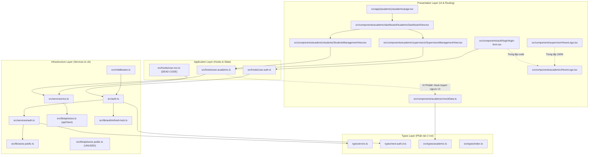
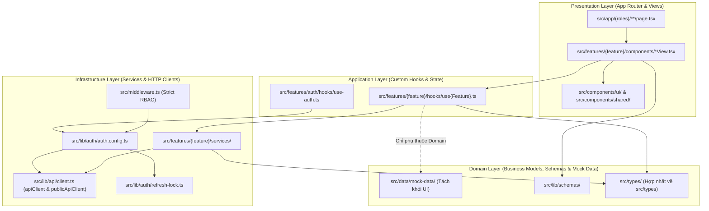
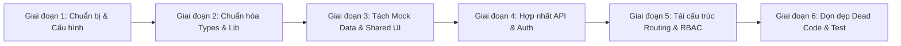

# BÁO CÁO KHẢO SÁT VÀ ĐỀ XUẤT TÁI CẤU TRÚC KIẾN TRÚC FRONTEND
# HỆ THỐNG QUẢN LÝ QUÁ TRÌNH ĐÀO TẠO TIẾN SĨ – TRƯỜNG ĐẠI HỌC AN GIANG (AGU)

- **Vai trò:** Senior Frontend Architect
- **Dự án:** Phân hệ Quản lý Quá trình Đào tạo Tiến sĩ — Trường Đại học An Giang (ĐHQG-HCM)
- **Tài liệu tham chiếu:** SRS v2.0, Kế hoạch thiết kế Frontend v1.0, Cơ chế Auth NextAuth v5
- **Ngày khảo sát:** 30/10/2026
- **Trạng thái:** Chờ phê duyệt (Chỉ đọc & Phân tích — Chưa áp dụng thay đổi mã nguồn)

---

## 1. TỔNG QUAN DỰ ÁN VÀ PHẠM VI KHẢO SÁT

Hệ thống Quản lý Quá trình Đào tạo Tiến sĩ của Trường Đại học An Giang phục vụ 6 nhóm tác nhân chính:
1. **Nghiên cứu sinh (NCS):** Quản lý tiến độ 9 mốc, nộp báo cáo/minh chứng, kê khai điểm bài báo khoa học (WoS/Scopus), nộp đơn gia hạn, đăng ký bảo vệ và xét tốt nghiệp.
2. **Giảng viên hướng dẫn (GVHD):** Theo dõi danh sách NCS hướng dẫn, giám sát định mức hạn ngạch BR-09 (Độc lập 1.0, Đồng HD 0.5, trần 3.0-4.0), xác nhận báo cáo tiến độ định kỳ (tháng 6/12) và minh chứng chuyên đề.
3. **Giáo vụ Sau Đại học (Academic Affairs Staff):** Tiếp nhận hàng chờ minh chứng, thẩm định hồ sơ 2 cấp, phân công GVHD theo hạn ngạch, kiểm tra điều kiện bảo vệ và xét tốt nghiệp.
4. **Đơn vị chuyên môn (Khoa/Bộ môn):** Tổ chức bảo vệ cấp cơ sở, đề xuất hội đồng, giám sát chuyên môn đào tạo.
5. **Hội đồng / Phản biện:** Đánh giá luận án online, nhập phiếu điểm, nhận xét ưu/khuyết điểm và bỏ phiếu đánh giá luận án.
6. **Quản trị viên (Admin):** Quản lý danh mục người dùng, phân quyền RBAC 6 vai trò, theo dõi nhật ký kiểm toán (audit log) và cấu hình hệ thống.

### Phạm vi khảo sát kỹ thuật:
- **Thư mục mục tiêu:** Toàn bộ thư mục `frontend/` (bao gồm `src/app/`, `src/components/`, `src/hooks/`, `src/lib/`, `src/services/`, `src/types/`, `frontend/types/`, `frontend/docs/`, và các file cấu hình).
- **Nguyên tắc tuân thủ:** CHỈ ĐỌC VÀ KHẢO SÁT. Không can thiệp mã nguồn backend, database, docker hay API contracts.

---

## 2. CÂY THƯ MỤC FRONTEND HIỆN TẠI (FULL DIRECTORY TREE)

```text
frontend/
├── .dockerignore
├── .env.example
├── .gitignore
├── AGENTS.md
├── CLAUDE.md
├── Dockerfile
├── README.md
├── components.json                     # Cấu hình shadcn/ui
├── eslint.config.mjs                   # Cấu hình ESLint 9 Flat Config
├── ke-hoach-frontend-tien-si.md        # Kế hoạch thiết kế giao diện ban đầu theo SRS v2.0
├── next.config.ts                      # Cấu hình Next.js
├── package-lock.json
├── package.json                        # Khai báo dependencies
├── postcss.config.mjs                  # Cấu hình PostCSS với Tailwind CSS v4
├── tsconfig.json                       # Cấu hình TypeScript compiler & path aliases
├── tsconfig.tsbuildinfo
├── docs/
│   └── auth-mechanism.md               # Tài liệu cơ chế xác thực NextAuth v5 & Refresh Lock
├── public/
│   ├── file.svg
│   ├── globe.svg
│   ├── next.svg
│   ├── vercel.svg
│   ├── window.svg
│   ├── fonts/
│   │   ├── PlusJakartaSans-Italic-VariableFont_wght.ttf
│   │   └── PlusJakartaSans-VariableFont_wght.ttf
│   └── image/
│       ├── TruongDHAG.webp
│       ├── logo 1.png
│       └── logo 2.png
├── types/                              # Thư mục types tại ROOT của frontend
│   ├── errors.ts                       # Custom error classes kế thừa CredentialsSignin
│   └── next-auth.d.ts                  # Type augmentation cho NextAuth (Session, JWT, User)
└── src/
    ├── auth.ts                         # Cấu hình cốt lõi NextAuth v5 (handlers, callbacks)
    ├── middleware.ts                   # Next.js Edge Middleware chặn route và refresh token
    ├── app/
    │   ├── favicon.ico
    │   ├── globals.css                 # CSS toàn cục, Tailwind directives, theme variables
    │   ├── layout.tsx                  # RootLayout nạp font Plus Jakarta Sans & Providers
    │   ├── page.tsx                    # Landing page giới thiệu Cổng Sau đại học
    │   ├── api/
    │   │   └── auth/
    │   │       └── [...nextauth]/
    │   │           └── route.ts        # Route Handler NextAuth /api/auth/[...nextauth]
    │   ├── (academic)/                 # Route Group Giáo vụ SĐH
    │   │   ├── layout.tsx              # Shell layout Giáo vụ (Header, Sidebar, Footer, SearchModal)
    │   │   ├── academic-affairs/
    │   │   │   └── page.tsx            # Redirect về /academic
    │   │   ├── blind-review/
    │   │   │   └── page.tsx            # Màn hình quản lý phản biện kín (stub)
    │   │   ├── committees/
    │   │   │   └── page.tsx            # Màn hình quản lý hội đồng (stub)
    │   │   ├── graduation-check/
    │   │   │   └── page.tsx            # Màn hình xét tốt nghiệp (stub)
    │   │   ├── publications/
    │   │   │   └── page.tsx            # Màn hình thẩm định công bố (stub)
    │   │   ├── review-queue/
    │   │   │   └── page.tsx            # Redirect về /academic?tab=evidence
    │   │   ├── students/
    │   │   │   └── [id]/
    │   │   │       └── page.tsx        # Chi tiết hồ sơ NCS theo ID (stub)
    │   │   ├── supervisors/
    │   │   │   └── page.tsx            # Redirect về /academic/supervisors
    │   │   └── academic/               # Nhánh trang làm việc tập trung của Giáo vụ
    │   │       ├── page.tsx            # Dashboard Giáo vụ tích hợp Tab view
    │   │       ├── calendar/
    │   │       │   └── page.tsx        # Lịch học vụ & sự kiện
    │   │       ├── evidence/
    │   │       │   └── page.tsx        # Tab minh chứng chuyên đề
    │   │       ├── faq/
    │   │       │   └── page.tsx        # Câu hỏi thường gặp học vụ
    │   │       ├── forms/
    │   │       │   └── page.tsx        # Biểu mẫu học vụ
    │   │       ├── procedures/
    │   │       │   └── page.tsx        # Quy trình thủ tục đào tạo
    │   │       ├── regulations/
    │   │       │   └── page.tsx        # Quy chế & quy định BR-09
    │   │       ├── students/
    │   │       │   └── page.tsx        # Bảng quản lý 18 NCS
    │   │       ├── supervisors/
    │   │       │   └── page.tsx        # Bảng quản lý hạn ngạch GVHD
    │   │       └── topic-changes/
    │   │           └── page.tsx        # Bảng duyệt đổi đề tài
    │   ├── (admin)/                    # Route Group Quản trị hệ thống
    │   │   ├── layout.tsx              # Layout admin (tạm thời dạng khung thô)
    │   │   ├── audit-log/
    │   │   │   └── page.tsx            # Nhật ký kiểm toán thao tác (stub)
    │   │   ├── system/
    │   │   │   └── page.tsx            # Cấu hình danh mục WoS/Scopus (stub)
    │   │   └── users/
    │   │       └── page.tsx            # Quản trị tài khoản & RBAC (stub)
    │   ├── (auth)/                     # Route Group Xác thực
    │   │   ├── layout.tsx              # Layout canh giữa form đăng nhập
    │   │   ├── forgot-password/
    │   │   │   └── page.tsx            # Màn hình quên mật khẩu (stub)
    │   │   └── login/
    │   │       └── page.tsx            # Trang đăng nhập chính
    │   ├── (committee)/                # Route Group Hội đồng & Phản biện
    │   │   ├── layout.tsx              # Layout hội đồng (khung thô)
    │   │   ├── review-forms/
    │   │   │   └── [id]/
    │   │   │       └── page.tsx        # Phiếu chấm điểm luận án online (stub)
    │   │   └── voting/
    │   │       └── [id]/
    │   │           └── page.tsx        # Bỏ phiếu luận án online (stub)
    │   ├── (student)/                  # Route Group Nghiên cứu sinh
    │   │   ├── layout.tsx              # Layout NCS (khung thô)
    │   │   ├── dashboard/
    │   │   │   └── page.tsx            # Tổng quan & timeline 9 mốc (stub)
    │   │   ├── defense/
    │   │   │   └── page.tsx            # Đăng ký bảo vệ luận án (stub)
    │   │   ├── extensions/
    │   │   │   └── page.tsx            # Đơn xin gia hạn học tập (stub)
    │   │   ├── graduation/
    │   │   │   └── page.tsx            # Xét hoàn tất tốt nghiệp (stub)
    │   │   ├── milestones/
    │   │   │   └── [id]/
    │   │   │       └── page.tsx        # Chi tiết mốc & nộp minh chứng (stub)
    │   │   └── my-publications/
    │   │       └── page.tsx            # Khai báo bài báo khoa học (stub)
    │   └── (supervisor)/               # Route Group Giảng viên hướng dẫn
    │       ├── layout.tsx              # Layout GVHD (khung thô)
    │       ├── page.tsx                # Redirect về /supervisor (XUNG ĐỘT VỚI root page.tsx!)
    │       ├── progress-reports/
    │       │   └── page.tsx            # Báo cáo tiến độ 6 tháng/12 tháng (stub)
    │       ├── quota/
    │       │   └── page.tsx            # Theo dõi hạn ngạch cá nhân (stub)
    │       ├── students/
    │       │   └── page.tsx            # Danh sách NCS đang hướng dẫn (stub)
    │       └── supervisor/
    │           └── page.tsx            # Dashboard GVHD chính (stub)
    ├── components/
    │   ├── footer.tsx                  # Root footer (DEAD CODE - không dùng)
    │   ├── header.tsx                  # Root header (DEAD CODE - không dùng)
    │   ├── providers.tsx               # QueryClientProvider & SessionProvider
    │   ├── academic/                   # Components nghiệp vụ Giáo vụ SĐH
    │   │   ├── ApprovalDialog.tsx      # Hộp thoại phê duyệt minh chứng 2 cấp (BR-04)
    │   │   ├── DocumentPreviewModal.tsx# Trình xem trước PDF inline có zoom, SHA-256
    │   │   ├── ExcelImportModal.tsx    # Modal import danh sách NCS/GVHD từ Excel/CSV
    │   │   ├── GlobalSearchModal.tsx   # Modal tìm kiếm nhanh toàn hệ thống (Ctrl+K)
    │   │   ├── HoverLogo.tsx           # Logo AGU chuyển đổi hiệu ứng khi hover
    │   │   ├── QuotaBar.tsx            # Thanh hạn ngạch GVHD theo BR-09
    │   │   ├── StudentDetailModal.tsx  # Modal xem chi tiết toàn bộ hồ sơ 1 NCS
    │   │   ├── SupervisorSelector.tsx  # Dropdown chọn GVHD có tính hạn ngạch thời gian thực
    │   │   ├── TopicChangeModal.tsx    # Modal duyệt điều chỉnh tên đề tài luận án
    │   │   ├── footer.tsx              # Footer chuẩn cổng Giáo vụ
    │   │   ├── header.tsx              # Header thanh tác vụ cổng Giáo vụ
    │   │   ├── index.ts                # Barrel export module academic
    │   │   ├── mockData.ts             # Dữ liệu tĩnh 18 NCS, GVHD, minh chứng (SAI VỊ TRÍ)
    │   │   ├── sidebar.tsx             # Sidebar điều hướng cổng Giáo vụ
    │   │   ├── dashboard/
    │   │   │   └── AcademicDashboardView.tsx # View giao diện tích hợp các tab học vụ
    │   │   ├── evidence/
    │   │   │   └── EvidenceManagementView.tsx# View tab hàng chờ duyệt minh chứng
    │   │   ├── students/
    │   │   │   └── StudentsManagementView.tsx# View tab bảng danh sách 18 NCS
    │   │   ├── supervisors/
    │   │   │   └── SupervisorsManagementView.tsx # View tab bảng hạn ngạch GVHD
    │   │   └── topic-changes/
    │   │       └── TopicChangesManagementView.tsx # View tab duyệt đổi đề tài
    │   ├── admin/                      # Components quản trị hệ thống
    │   │   ├── footer.tsx              # Footer admin (DEAD CODE)
    │   │   ├── header.tsx              # Header admin (DEAD CODE)
    │   │   └── sidebar.tsx             # Sidebar admin (DEAD CODE)
    │   ├── auth/                       # Components xác thực
    │   │   └── login/
    │   │       ├── first-login-password-modal.tsx # Modal ép đổi mật khẩu lần đầu
    │   │       ├── login-form.tsx      # Form đăng nhập chính (chứa HoverLogo trùng lặp)
    │   │       └── mock-account-switcher.tsx # Bộ chuyển đổi nhanh tài khoản demo
    │   ├── defense/                    # Components bảo vệ luận án (STUBS)
    │   │   ├── BlindReviewStatus.tsx   # Stub
    │   │   ├── DefenseStepper.tsx      # Stub
    │   │   └── index.ts
    │   ├── milestone/                  # Components tiến độ 9 mốc (STUBS)
    │   │   ├── MilestoneCard.tsx       # Stub
    │   │   ├── MilestoneTimeline.tsx   # Stub
    │   │   ├── StatusBadge.tsx         # Badge trạng thái 5 mức
    │   │   └── index.ts
    │   ├── notification/               # Components thông báo (STUBS)
    │   │   ├── NotificationBell.tsx    # Stub
    │   │   ├── NotificationList.tsx    # Stub
    │   │   └── index.ts
    │   ├── publication/                # Components bài báo khoa học (STUBS)
    │   │   ├── PublicationForm.tsx     # Stub
    │   │   ├── ScoreAccumulator.tsx    # Stub
    │   │   └── index.ts
    │   ├── review/                     # Components chấm điểm hội đồng (STUBS)
    │   │   ├── ReviewForm.tsx          # Stub
    │   │   ├── ScoreInput.tsx          # Stub
    │   │   ├── ScoreSummaryTable.tsx   # Stub
    │   │   └── index.ts
    │   ├── shared/                     # Components dùng chung (STUBS)
    │   │   ├── ConfirmDialog.tsx       # Stub (Trùng lặp mục đích với ApprovalDialog)
    │   │   ├── DeadlineCountdown.tsx   # Stub
    │   │   ├── DeadlineWarningBanner.tsx # Stub
    │   │   └── index.ts
    │   ├── student/                    # Components layout NCS
    │   │   ├── footer.tsx              # Footer NCS (DEAD CODE)
    │   │   ├── header.tsx              # Header NCS (DEAD CODE)
    │   │   └── sidebar.tsx             # Sidebar NCS (DEAD CODE)
    │   ├── supervisor/                 # Components GVHD
    │   │   ├── HoverLogo.tsx           # Trùng lặp 100% với academic/HoverLogo.tsx
    │   │   ├── QuotaBar.tsx            # Stub (Bị bỏ quên trong khi academic/QuotaBar đã hoàn chỉnh)
    │   │   ├── SupervisorSelector.tsx  # Stub (Bị bỏ quên trong khi academic đã hoàn chỉnh)
    │   │   ├── footer.tsx              # Footer GVHD (DEAD CODE)
    │   │   ├── header.tsx              # Header GVHD (DEAD CODE)
    │   │   ├── index.ts
    │   │   └── sidebar.tsx             # Sidebar GVHD (DEAD CODE)
    │   ├── ui/                         # shadcn/ui base components
    │   │   ├── button.tsx
    │   │   ├── card.tsx
    │   │   ├── field.tsx
    │   │   ├── input.tsx
    │   │   ├── label.tsx
    │   │   └── separator.tsx
    │   └── upload/                     # Components xử lý tài liệu & PDF (STUBS)
    │       ├── PdfUploader.tsx         # Stub
    │       ├── PdfViewer.tsx           # Stub (Bị thay thế bởi DocumentPreviewModal)
    │       ├── UploadProgress.tsx      # Stub
    │       └── index.ts
    ├── hooks/
    │   ├── use-academic.ts             # React Query hooks cho Giáo vụ (phụ thuộc mockData)
    │   ├── use-auth.ts                 # Hook đăng nhập, điều hướng và ánh xạ lỗi
    │   └── use-ncs.ts                  # Hook React Query đơn lẻ (DEAD CODE trùng lặp)
    ├── lib/
    │   ├── axios-public.ts             # Axios instance cho public API (ĐƯỢC DÙNG)
    │   ├── mock-accounts.ts            # Dữ liệu tài khoản mẫu demo đổi mật khẩu
    │   ├── api/
    │   │   ├── axios-public.ts         # FILE TRÙNG LẶP (DEAD CODE - cấu hình khác nhau)
    │   │   ├── axios.ts                # Axios instance có auth interceptor & refresh token
    │   │   ├── client.ts               # apiFetch native wrapper (DEAD CODE - không dùng)
    │   │   └── index.ts                # Barrel export chỉ xuất apiFetch
    │   ├── auth/
    │   │   ├── constants.ts            # Khai báo UserRole, ROLE_ROUTES, ROUTE_GROUP_ROLES
    │   │   ├── index.ts                # Barrel export auth
    │   │   └── refresh-lock.ts         # Promise Lock chống race condition khi refresh token
    │   ├── schemas/                    # Zod validation schemas
    │   │   ├── index.ts
    │   │   ├── student.ts              # Schema import dữ liệu NCS
    │   │   └── supervisor.ts           # Schema import dữ liệu GVHD & BR-09
    │   └── utils/
    │       ├── index.ts                # Helper format ngày, giờ, kích thước file
    │       └── jwt.ts                  # Giải mã JWT exp bằng thư viện jose
    ├── services/
    │   ├── auth.ts                     # Gọi API login, logout, refreshToken, getMe
    │   └── ncs.ts                      # Gọi API lấy danh sách NCS từ backend
    └── types/                          # Thư mục types trong src
        ├── academic.ts                 # Domain types của phân hệ Giáo vụ (StudentDossier, etc.)
        └── index.ts                    # Barrel export types và type mẫu theo SRS
```

---

## 3. ĐÁNH GIÁ CẤU TRÚC HIỆN TẠI

### 3.1. Điểm mạnh đã đạt được:
1. **Kiến trúc Xác thực (Authentication) tiên tiến:** Sử dụng NextAuth v5 (Auth.js beta 32) kết hợp với JWT session, Edge Middleware và cơ chế **Promise Lock (`withRefreshLock`)** ngăn chặn triệt để tình trạng race condition khi nhiều request đồng thời kích hoạt refresh token.
2. **Xử lý lỗi HTTP thành các Error Class định danh:** `src/services/auth.ts` chuyển đổi mã HTTP backend (400, 401, 403, 409) thành các class kế thừa `CredentialsSignin` (`UnauthorizedError`, `InActiveAccountError`, `InvalidParameters`, `ConflictAccountError`), giúp `use-auth.ts` hiển thị thông báo tiếng Việt chính xác và trực quan.
3. **Phân hệ Giáo vụ SĐH (`(academic)`) được xây dựng chuyên sâu:** Các View tab (`StudentsManagementView`, `SupervisorsManagementView`, `EvidenceManagementView`, `TopicChangesManagementView`), các Modal phức tạp (`ApprovalDialog`, `DocumentPreviewModal`, `ExcelImportModal`) có độ hoàn thiện UI cao, đáp ứng trực tiếp các quy chuẩn nghiệp vụ của AGU (như Quy chế BR-09 về định mức hướng dẫn và tiêu chuẩn bài báo WoS/Scopus).
4. **Validation dữ liệu chặt chẽ bằng Zod:** `src/lib/schemas/student.ts` và `supervisor.ts` kiểm tra chi tiết biểu thức regex mã số (`NCS\d{6}`, `CB-\d{4}-\d{3}`), hạn ngạch lũy tiến và tiêu chuẩn học vị tối thiểu.

### 3.2. Điểm yếu và Hạn chế nghiêm trọng:
1. **Phát triển không đồng bộ (Asymmetrical Implementation):** Chỉ có phân hệ Giáo vụ (`academic`) và trang Đăng nhập (`login`) là có mã nguồn hoàn chỉnh. Năm phân hệ còn lại (`student`, `supervisor`, `admin`, `committee`, và các màn hình phụ của `academic`) chỉ tồn tại dưới dạng file rỗng/stub 3–14 dòng code.
2. **Xung đột định tuyến (Route Collisions) trong App Router:** Do Route Group `(name)` bị xóa khỏi URL khi runtime, cả `src/app/page.tsx` và `src/app/(supervisor)/page.tsx` đều định vị tại root path `/`. Tương tự, `/students` được ánh xạ cho GVHD nhưng `/students/[id]` lại nằm ở nhánh Giáo vụ với layout hoàn toàn khác nhau.
3. **Trùng lặp mã nguồn (Code Duplication) mức độ cao:** Thành phần `HoverLogo` được sao chép nguyên khối ở 3 vị trí khác nhau; `QuotaBar` và `SupervisorSelector` được viết hoàn chỉnh ở `components/academic/` trong khi ở `components/supervisor/` lại để stub rỗng; `axios-public.ts` tồn tại 2 bản song song với cấu hình khác nhau.
4. **Vi phạm nguyên tắc Clean Architecture (Inverted Dependencies):** Tầng Hooks logic (`use-academic.ts`) lại đi import dữ liệu tĩnh `mockData.ts` từ tầng Component UI (`src/components/academic/mockData.ts`).
5. **Phân tán cấu trúc Types:** Có 2 thư mục types song song (`frontend/types/` ở root và `frontend/src/types/`).
6. **Lệch cấu hình Alias và Thư viện:** `tsconfig.json` cấu hình `"@/*": ["./*"]` thay vì `"./src/*"`, làm sai lệch toàn bộ cấu hình của shadcn/ui (`components.json`) và buộc các file phải import dạng `@/src/...`. Nhiều thư viện quy định trong kế hoạch (`zustand`, `react-hook-form`, `openapi-typescript`, `date-fns`) chưa hề được cài đặt trong `package.json`.

---

## 4. PHÂN TÍCH CHI TIẾT TỪNG TẦNG KỸ THUẬT

### 4.1. Phân tích Next.js App Router & Routing System

Bảng tổng hợp toàn bộ 37 Route Pages hiện tại và phân tích trạng thái:

| Route URL thực tế | File Path hiện tại | Trạng thái | Phân tích nghiệp vụ & Vấn đề kiến trúc |
|---|---|---|---|
| `/` | `src/app/page.tsx` | Hoàn chỉnh | Landing page cổng Sau đại học. |
| `/` **(XUNG ĐỘT)** | `src/app/(supervisor)/page.tsx` | Lỗi kiến trúc | Chứa `redirect("/supervisor")`. **Xung đột trực tiếp với `src/app/page.tsx`** trên cùng URL `/`. Next.js sẽ báo lỗi trùng lặp route khi build production. |
| `/login` | `src/app/(auth)/login/page.tsx` | Hoàn chỉnh | Trang đăng nhập chính, tích hợp first-login modal và demo switcher. |
| `/forgot-password` | `src/app/(auth)/forgot-password/page.tsx` | Stub (8 dòng) | Quên mật khẩu, chưa triển khai form. |
| `/dashboard` | `src/app/(student)/dashboard/page.tsx` | Stub (8 dòng) | Dashboard NCS. Chưa gắn các component timeline 9 mốc. |
| `/milestones/[id]` | `src/app/(student)/milestones/[id]/page.tsx` | Stub (14 dòng) | Chi tiết mốc và nộp minh chứng của NCS. |
| `/my-publications` | `src/app/(student)/my-publications/page.tsx` | Stub (9 dòng) | Khai báo bài báo khoa học của NCS. |
| `/defense` | `src/app/(student)/defense/page.tsx` | Stub (9 dòng) | Đăng ký bảo vệ luận án 3 bước. |
| `/graduation` | `src/app/(student)/graduation/page.tsx` | Stub (9 dòng) | Hồ sơ xét tốt nghiệp NCS. |
| `/extensions` | `src/app/(student)/extensions/page.tsx` | Stub (9 dòng) | Đơn xin gia hạn học tập. |
| `/students` | `src/app/(supervisor)/students/page.tsx` | Stub (3 dòng) | Danh sách NCS do GVHD hướng dẫn. **Xung đột ngữ nghĩa với Giáo vụ**. |
| `/quota` | `src/app/(supervisor)/quota/page.tsx` | Stub (3 dòng) | Hạn ngạch cá nhân GVHD. |
| `/progress-reports` | `src/app/(supervisor)/progress-reports/page.tsx` | Stub (3 dòng) | Báo cáo tiến độ định kỳ 6/12 tháng. |
| `/supervisor` | `src/app/(supervisor)/supervisor/page.tsx` | Stub (3 dòng) | Trang chủ làm việc GVHD (chỉ chứa thẻ div rỗng). |
| `/academic` | `src/app/(academic)/academic/page.tsx` | Hoàn chỉnh | Dashboard Giáo vụ tập trung (chứa `AcademicDashboardView`). |
| `/academic/students` | `src/app/(academic)/academic/students/page.tsx` | Hoàn chỉnh | Bảng quản lý 18 NCS của Giáo vụ. |
| `/academic/supervisors` | `src/app/(academic)/academic/supervisors/page.tsx` | Hoàn chỉnh | Bảng giám sát hạn ngạch GVHD toàn trường theo BR-09. |
| `/academic/evidence` | `src/app/(academic)/academic/evidence/page.tsx` | Hoàn chỉnh | Hàng chờ duyệt minh chứng học vụ. |
| `/academic/topic-changes` | `src/app/(academic)/academic/topic-changes/page.tsx` | Hoàn chỉnh | Duyệt đổi tên đề tài luận án. |
| `/academic/calendar` | `src/app/(academic)/academic/calendar/page.tsx` | Hoàn chỉnh (71 dòng) | Lịch biểu học vụ, sự kiện bảo vệ và hạn nộp. |
| `/academic/procedures` | `src/app/(academic)/academic/procedures/page.tsx` | Hoàn chỉnh (107 dòng) | Hướng dẫn thủ tục đào tạo tiến sĩ. |
| `/academic/forms` | `src/app/(academic)/academic/forms/page.tsx` | Hoàn chỉnh (98 dòng) | Danh mục biểu mẫu quy chuẩn. |
| `/academic/regulations` | `src/app/(academic)/academic/regulations/page.tsx` | Hoàn chỉnh (86 dòng) | Văn bản quy chế đào tạo & định mức BR-09. |
| `/academic/faq` | `src/app/(academic)/academic/faq/page.tsx` | Hoàn chỉnh (104 dòng) | Hỏi đáp thắc mắc đào tạo SĐH. |
| `/students/[id]` | `src/app/(academic)/students/[id]/page.tsx` | Stub (13 dòng) | Chi tiết hồ sơ 1 NCS phía Giáo vụ. Dùng layout của `(academic)` trong khi `/students` lại dùng layout của `(supervisor)`. |
| `/review-queue` | `src/app/(academic)/review-queue/page.tsx` | Redirect (5 dòng) | Redirect về `/academic?tab=evidence`. Trang thừa thãi. |
| `/supervisors` | `src/app/(academic)/supervisors/page.tsx` | Redirect (5 dòng) | Redirect về `/academic/supervisors`. Trang thừa thãi. |
| `/academic-affairs` | `src/app/(academic)/academic-affairs/page.tsx` | Redirect (5 dòng) | Redirect về `/academic`. Trang thừa thãi. |
| `/committees` | `src/app/(academic)/committees/page.tsx` | Stub (9 dòng) | Quản lý hội đồng bảo vệ phía Giáo vụ. |
| `/publications` | `src/app/(academic)/publications/page.tsx` | Stub (9 dòng) | Thẩm định bài báo khoa học phía Giáo vụ. |
| `/blind-review` | `src/app/(academic)/blind-review/page.tsx` | Stub (9 dòng) | Quản lý gửi và theo dõi phản biện kín. |
| `/graduation-check` | `src/app/(academic)/graduation-check/page.tsx` | Stub (9 dòng) | Thẩm tra điều kiện tốt nghiệp. |
| `/review-forms/[id]` | `src/app/(committee)/review-forms/[id]/page.tsx` | Stub (14 dòng) | Phiếu nhận xét luận án của Hội đồng/Phản biện. |
| `/voting/[id]` | `src/app/(committee)/voting/[id]/page.tsx` | Stub (14 dòng) | Bỏ phiếu biểu quyết luận án online. |
| `/users` | `src/app/(admin)/users/page.tsx` | Stub (9 dòng) | Quản lý tài khoản người dùng & RBAC. |
| `/audit-log` | `src/app/(admin)/audit-log/page.tsx` | Stub (9 dòng) | Nhật ký kiểm toán thao tác hệ thống. |
| `/system` | `src/app/(admin)/system/page.tsx` | Stub (8 dòng) | Cấu hình danh mục tạp chí WoS/Scopus. |

**Đánh giá Layouts:**
- `src/app/layout.tsx`: Root Layout tốt, tải font local `PlusJakartaSans` và bọc `Providers` (`QueryClientProvider`, `SessionProvider`).
- `src/app/(academic)/layout.tsx`: Layout hoàn chỉnh nhất, tích hợp `AcademicSidebar`, `AcademicHeader`, `AcademicFooter`, và phím tắt `Ctrl+K` mở `GlobalSearchModal`.
- `src/app/(admin)/layout.tsx`, `(committee)/layout.tsx`, `(student)/layout.tsx`, `(supervisor)/layout.tsx`: Đều là các khung tạm bợ, tự viết thẻ `<aside>` thô hoặc thẻ `<div>` rỗng, hoàn toàn KHÔNG sử dụng các component sidebar/header đã được chuẩn bị sẵn trong thư mục `components/`.

### 4.2. Phân tích Components & UI

Phân loại 34 component hiện tại:

1. **Nhóm Base UI (`components/ui/`):**
   - Đã sinh mã từ shadcn/ui: `button.tsx`, `card.tsx`, `field.tsx`, `input.tsx`, `label.tsx`, `separator.tsx`.
   - Lưu ý: `button.tsx` đang dùng `import { cn } from "cn"` (gói npm `cn`) thay vì utility `clsx` + `tailwind-merge` thông thường.

2. **Nhóm Component Phân hệ Giáo vụ (`components/academic/`):**
   - **Đầy đủ nghiệp vụ & Tái sử dụng cao:**
     - `QuotaBar.tsx` (140 dòng): Đo lường trực quan hạn ngạch GVHD theo BR-09 (Độc lập 1.0, Đồng HD 0.5, ngưỡng 80% cảnh báo vàng, 100% cảnh báo đỏ). Đang đặt riêng ở `academic/`, cần chuyển thành **Domain Shared Component** dùng chung cho cả GVHD và Giáo vụ.
     - `SupervisorSelector.tsx` (191 dòng): Dropdown chọn GVHD kèm xem trước hạn ngạch thời gian thực và cảnh báo vượt ngưỡng. Cần chuyển thành **Domain Shared Component**.
     - `DocumentPreviewModal.tsx` (264 dòng): Trình xem tài liệu PDF inline chuyên nghiệp, hỗ trợ zoom, phân trang, kiểm tra tính toàn vẹn SHA-256. Có thể phục vụ cho cả NCS, GVHD, Giáo vụ và Hội đồng. Nên đưa về `components/shared/` hoặc `components/features/documents/`.
     - `ApprovalDialog.tsx` (393 dòng): Hộp thoại phê duyệt/từ chối/yêu cầu sửa đổi có xác nhận 2 bước không thể hoàn tác (BR-04). Dùng được cho cả GVHD và Giáo vụ.
     - `ExcelImportModal.tsx` (1036 dòng): Công cụ import Excel cực kỳ hoàn chỉnh, validate dữ liệu 2 tầng với Zod.
     - `GlobalSearchModal.tsx` (238 dòng): Quick switcher tìm kiếm nhanh NCS, GVHD, thủ tục.
     - `StudentDetailModal.tsx` (271 dòng): Hiển thị hồ sơ toàn diện của NCS.
     - `TopicChangeModal.tsx` (238 dòng): Xem và duyệt đề nghị đổi tên đề tài.
   - **Views chuyên biệt cho màn hình:**
     - `AcademicDashboardView`, `StudentsManagementView`, `SupervisorsManagementView`, `EvidenceManagementView`, `TopicChangesManagementView`. Các view này phục vụ đúng kiến trúc Clean Views cho Next.js pages.

3. **Nhóm Component Trùng lặp & Dead Code:**
   - `HoverLogo.tsx`: Bị nhân bản tại 3 file:
     - `src/components/academic/HoverLogo.tsx`
     - `src/components/supervisor/HoverLogo.tsx` (giống 100%)
     - Viết trực tiếp trong `src/components/auth/login/login-form.tsx` (dòng 22–80).
   - `components/header.tsx` và `components/footer.tsx`: Nằm ở root components nhưng không layout nào import.
   - `components/admin/` (`header.tsx`, `sidebar.tsx`, `footer.tsx`): Không được `(admin)/layout.tsx` sử dụng.
   - `components/student/` (`header.tsx`, `sidebar.tsx`, `footer.tsx`): Không được `(student)/layout.tsx` sử dụng.
   - `components/supervisor/` (`header.tsx`, `sidebar.tsx`, `footer.tsx`, `QuotaBar.tsx` stub, `SupervisorSelector.tsx` stub): Hoàn toàn không được sử dụng.
   - Các thư mục stub rỗng: `defense/`, `notification/`, `publication/`, `review/`, `shared/` (`ConfirmDialog`, `DeadlineCountdown`, `DeadlineWarningBanner`), `upload/` (`PdfUploader`, `PdfViewer`, `UploadProgress`). Không có bất kỳ trang nào import các file này ngoài barrel file `index.ts` của chính nó.

### 4.3. Phân tích Hooks & State Management

Hiện tại dự án có 3 hooks tại `src/hooks/`:

1. **`use-auth.ts`:**
   - **Chức năng:** Quản lý state đăng nhập client, gọi `signIn("credentials", { redirect: false })`, bắt mã lỗi (`UNAUTHORIZED`, `INACTIVE_ACCOUNT`, `BAD_REQUEST`, `ACCOUNT_CONFLICT`) và ánh xạ sang câu thông báo tiếng Việt.
   - **Vấn đề kiến trúc:** Dòng 48 cố định `router.push("/dashboard")`. Dẫn đến việc bất kỳ role nào đăng nhập thành công (Admin, Giáo vụ, GVHD) đều bị chuyển hướng về màn hình dashboard của NCS thay vì phân luồng theo `ROLE_ROUTES` tương ứng.

2. **`use-academic.ts`:**
   - **Chức năng:** Tích hợp TanStack Query v5 (`useQuery`) cung cấp 4 queries: `useAcademicStudents`, `useAcademicSupervisors`, `useAcademicEvidences`, `useAcademicTopicChanges`.
   - **Cơ chế:** Thiết lập `staleTime: 5 phút`, `refetchOnWindowFocus: false`. Gọi `NcsService.getAllStudentsWithPagination()`, có fallback thông minh về dữ liệu mẫu `MOCK_STUDENTS` khi backend chưa sẵn sàng.
   - **Vi phạm kiến trúc (Inverted Dependency):** Dòng 10 import trực tiếp từ `@/src/components/academic/mockData`. Tầng logic/application hook phụ thuộc ngược vào tầng UI component.

3. **`use-ncs.ts`:**
   - **Chức năng:** Gọi `NcsService.getAllStudentsWithPagination()` bằng TanStack Query.
   - **Vấn đề kiến trúc:** **Hoàn toàn trùng lặp** với `useAcademicStudents` trong `use-academic.ts` và không được bất kỳ file nào import (Dead code).

4. **Tình trạng State Management:**
   - **TanStack Query:** Đã cài đặt (`@tanstack/react-query: ^5.104.1`) và hoạt động tốt qua `Providers`.
   - **Zustand:** **Chưa được cài đặt** trong `package.json` và chưa có store nào được tạo, mặc dù tài liệu kế hoạch ban đầu yêu cầu dùng Zustand để quản lý global client state (ví dụ: UI filters, active modal, user preferences).

### 4.4. Phân tích Lib, API Client & Services

1. **API Client & Axios Instances:**
   - `src/lib/axios-public.ts`: Cấu hình Axios instance cho API không cần token (login, refresh). Xử lý linh hoạt base URL cho cả SSR (`process.env.API_INTERNAL_URL`) và CSR (`process.env.NEXT_PUBLIC_API_URL`). **File này đang được sử dụng chính thức bởi `src/services/auth.ts`**.
   - `src/lib/api/axios-public.ts`: **File trùng lặp thừa thãi**. Chỉ hỗ trợ `NEXT_PUBLIC_API_URL` và không được bất kỳ đâu sử dụng.
   - `src/lib/api/axios.ts`: Cấu hình `apiClient` có Request Interceptor tự gắn Bearer Token lấy từ `getSession()` của NextAuth, và Response Interceptor tự gọi `signOut({ callbackUrl: "/login" })` khi nhận lỗi 401. Đang được dùng bởi `src/services/ncs.ts`.
   - `src/lib/api/client.ts`: Định nghĩa hàm `apiFetch` dùng native `fetch` với `credentials: "include"`. Hoàn toàn không được sử dụng ở đâu (Dead code).
   - `src/lib/api/index.ts`: Barrel file chỉ export `apiFetch`, bỏ qua `apiClient` và `publicApiClient`.

2. **Authentication Utilities:**
   - `src/lib/auth/refresh-lock.ts`: Cơ chế Promise Lock mẫu mực bằng `Map<string, Promise<RefreshResult>>` giải quyết bài toán concurrency refresh token trong Next.js SSR/Edge runtime.
   - `src/lib/utils/jwt.ts`: Sử dụng thư viện `jose` để decode payload token lấy `exp` (tương thích Edge Runtime, không cần secret).
   - `src/lib/auth/constants.ts`: Định nghĩa danh sách vai trò `UserRole`. Tuy nhiên, biến `ROLE_ROUTES` và `ROUTE_GROUP_ROLES` định nghĩa route group chứa dấu ngoặc tròn như `"/(student)"`, gây sai lệch logic so sánh URL.

3. **Business Services:**
   - `src/services/auth.ts`: Triển khai đầy đủ `login`, `getMe`, `refreshToken`, `logout`. Xử lý lỗi tập trung, ném ra các Error Class chuyên biệt.
   - `src/services/ncs.ts`: Triển khai hàm `getAllStudentsWithPagination` gọi endpoint `/ncs`.

### 4.5. Phân tích Authentication và RBAC

1. **NextAuth Core (`src/auth.ts`):**
   - Triển khai chuẩn Auth.js v5 beta 32.
   - Khởi tạo Provider `CredentialsProvider`.
   - JWT Callback quản lý vòng đời token chặt chẽ: Lưu `access_token`, `refresh_token`, giải mã hạn dùng qua `getTokenExpire`, thêm 60 giây buffer time an toàn. Khi token hết hạn, gọi refresh thông qua `withRefreshLock`.
   - Session Callback ánh xạ chính xác token vào session object cho client.
   - Event `signOut` gọi API revoke refresh token phía backend.

2. **Middleware bảo vệ Route (`src/middleware.ts`):**
   - Chặn request tại Edge level thông qua hàm bọc `auth(...)`.
   - Tự động bắt lỗi `authError === "RefreshTokenError"` để đẩy user về `/login`.
   - Cho phép các route công cộng thông qua `PUBLIC_ROUTES`.
   - **Lỗ hổng & Thiếu sót nghiêm trọng:**
     - Danh sách `PUBLIC_ROUTES` đang mở toang hàng loạt route nhạy cảm của Giáo vụ và GVHD: `["/academic", "/academic-affairs", "/supervisor", "/students", "/quota", "/progress-reports", "/review-queue", "/supervisors"]`. Đây là cấu hình tạm trong lúc làm demo, cần phải đóng lại ngay khi kích hoạt RBAC thật.
     - Dòng 56–60: Logic kiểm tra quyền RBAC theo vai trò (`UserRole`) mới chỉ dừng lại ở comment `// TODO: implement strict RBAC matching`. Chưa có cơ chế ngăn chặn việc một NCS truy cập vào URL của Giáo vụ hay Admin nếu đã đăng nhập.

3. **Xung đột Role Naming:**
   - Trong `src/lib/auth/constants.ts` và `src/types/index.ts`: Role là chữ hoa chuẩn hệ thống: `"NCS" | "GVHD" | "GIAO_VU" | "DON_VI_CHUYEN_MON" | "HOI_DONG" | "ADMIN"`.
   - Trong `src/lib/mock-accounts.ts`: Role lại là chữ thường: `'student' | 'supervisor' | 'academic' | 'admin'`. Gây không đồng nhất khi test tài khoản mẫu.

### 4.6. Phân tích Types & Schemas

1. **Phân bố vị trí Types:**
   - `frontend/types/`: Chứa `errors.ts` (Error classes) và `next-auth.d.ts` (NextAuth module augmentation).
   - `frontend/src/types/`: Chứa `academic.ts` (Domain types nghiệp vụ Giáo vụ) và `index.ts` (Barrel export kèm type phác thảo ban đầu).
   - **Vấn đề:** Sự phân tách giữa thư mục `types/` bên ngoài và `src/types/` bên trong là hệ quả của việc cấu hình alias sai trong `tsconfig.json`. Tất cả nên được quy về một mối trong `src/types/` để dễ quản lý.

2. **Trùng lặp và Không nhất quán:**
   - Type `UserRole` được khai báo 2 lần: trong `src/lib/auth/constants.ts` và trong `src/types/index.ts`.
   - Type thông tin người dùng bị phân mảnh: `IUser` trong `next-auth.d.ts` (id, fullName, username, role, email) và `User` trong `src/types/index.ts` (id, email, fullName, role).
   - Type hồ sơ NCS: `Student` trong `src/types/index.ts` (theo hướng quan hệ database: milestones, user, maxEndDate) và `StudentDossier` trong `src/types/academic.ts` (theo hướng giao diện nghiệp vụ học vụ: remainingMonths, publicationPoints, supervisorMain). Cần chuẩn hóa rõ ràng giữa **Entity Model** (từ API backend) và **UI View Model**.

3. **Validation Schemas (`src/lib/schemas/`):**
   - `student.ts`: `studentImportSchema`, `rawStudentRowSchema` (đạt chuẩn).
   - `supervisor.ts`: `supervisorImportSchema`, `rawSupervisorRowSchema` (đạt chuẩn).
   - Được `ExcelImportModal.tsx` tái sử dụng rất hiệu quả.

### 4.7. Phân tích Cấu hình (Config, Build & Dependencies)

1. **Cấu hình TypeScript (`tsconfig.json`):**
   ```json
   "paths": {
     "@/*": ["./*"],
     "@/image/*": ["./public/image/*"],
     "@/fonts/*": ["./public/fonts/*"]
   }
   ```
   - **Vấn đề cốt lõi:** `"@/*": ["./*"]` trỏ vào thư mục gốc của frontend chứ không phải `./src/*`.
   - Hậu quả: Mọi import trong dự án đều phải viết dài dòng: `@/src/components/...`, `@/src/lib/...`, `@/types/...`.
   - Xung đột với shadcn/ui: File `components.json` được cấu hình chuẩn:
     ```json
     "aliases": {
       "components": "@/components",
       "utils": "@/lib/utils",
       "ui": "@/components/ui",
       "lib": "@/lib",
       "hooks": "@/hooks"
     }
     ```
     Khi chạy lệnh `npx shadcn add`, CLI sẽ tạo file và import theo alias `@/components`, nhưng TypeScript lại tìm ở root `./components` thay vì `./src/components`, dẫn đến lỗi phân giải đường dẫn.

2. **Lỗi Biên dịch TypeScript Hiện tại (`tsc --noEmit`):**
   Khi chạy kiểm tra type toàn diện, phát hiện **7 lỗi TypeScript** trong 3 file:
   - `src/components/academic/HoverLogo.tsx` (dòng 5, 6): Lỗi `TS2307: Cannot find module '@/public/image/logo 1.png'`.
   - `src/components/supervisor/HoverLogo.tsx` (dòng 5, 6): Lỗi `TS2307: Cannot find module '@/public/image/logo 1.png'`.
   - `src/components/auth/login/login-form.tsx` (dòng 8, 9, 10): Lỗi `TS2307: Cannot find module '@/public/image/TruongDHAG.webp'`, `logo 1.png`.
   - **Nguyên nhân:** Thiếu file khai báo ambient module declarations cho file ảnh (`declare module "*.png"`, `declare module "*.webp"`) và đường dẫn file chứa khoảng trắng (`logo 1.png`).

3. **Hiện trạng Thư viện thực tế (`package.json`):**
   - **Next.js:** Đang sử dụng `"next": "16.3.8"`, `"react": "19.2.8"`. (Lưu ý: SRS và prompt đề cập Next.js 15, nhưng dự án thực tế đã khởi tạo với bản Next.js canary/16 và React 19).
   - **Tailwind CSS:** Sử dụng `@tailwindcss/postcss: ^4` và `tailwindcss: ^4` (Tailwind v4 mới nhất).
   - **Zod:** Được sử dụng rất nhiều trong `src/lib/schemas/`, file `node_modules` có phiên bản 4.6.5, **nhưng Zod KHÔNG được khai báo trong `package.json`** (đang chạy nhờ dependency bắc cầu). Nếu cài đặt trên môi trường CI/CD sạch, dự án sẽ gãy build do thiếu Zod.
   - **Các thư viện theo kế hoạch nhưng HOÀN TOÀN CHƯA CÀI:**
     - `zustand` (State management)
     - `react-hook-form` (Quản lý form)
     - `openapi-typescript` (Tự động sinh type từ backend Swagger)
     - `date-fns` (Format ngày giờ tiếng Việt, hiện tại utils đang phải viết hàm tự chế tạm)

---

## 5. NHỮNG VẤN ĐỀ KIẾN TRÚC PHÁT HIỆN ĐƯỢC

### Vấn đề 1: Xung đột Route nghiêm trọng tại Root URL (`/`)
- Cả `src/app/page.tsx` và `src/app/(supervisor)/page.tsx` đều biên dịch ra cùng một route URL là `/`.
- Trong App Router, tên thư mục trong ngoặc tròn `(supervisor)` là route group vô hình. Hai file `page.tsx` cùng cấp URL sẽ gây xung đột không thể giải quyết khi build production.

### Vấn đề 2: Lệch pha cấu trúc Layout và Route giữa các vai trò
- URL `/students` thuộc về `(supervisor)/students/page.tsx` (sử dụng `(supervisor)/layout.tsx`).
- URL `/students/[id]` lại thuộc về `(academic)/students/[id]/page.tsx` (sử dụng `(academic)/layout.tsx`).
- Kết quả: Khi người dùng truy cập danh sách sinh viên thì thấy một giao diện layout, nhưng bấm vào xem chi tiết một sinh viên thì giao diện header/sidebar bị giật đổi hoàn toàn sang layout của vai trò khác.

### Vấn đề 3: Phân mảnh kiến trúc Điều hướng của Phân hệ Giáo vụ
- Hiện tại phân hệ Giáo vụ đang tồn tại song song 3 cách tiếp cận định tuyến:
  1. Dạng Dashboard Tab trên 1 trang: `/academic?tab=students`, `/academic?tab=evidence` (xử lý qua `AcademicDashboardView`).
  2. Dạng Trang độc lập con: `/academic/students`, `/academic/supervisors`, `/academic/evidence`.
  3. Dạng Redirect thừa: `/review-queue` -> redirect về `?tab=evidence`, `/supervisors` -> redirect về `/academic/supervisors`.
- Việc này tạo ra các route dư thừa, gây khó khăn cho việc quản lý caching và breadcrumb.

### Vấn đề 4: Vi phạm nguyên tắc Dependency Inversion (Clean Architecture)
- `src/hooks/use-academic.ts` (Application/Logic Layer) lại `import { MOCK_STUDENTS, ... } from "@/src/components/academic/mockData"` (Presentation/UI Layer).
- Thành phần dữ liệu nghiệp vụ tĩnh (`mockData.ts` dài 444 dòng) bị đặt bên trong thư mục `components/academic/`.

### Vấn đề 5: Nhân bản mã nguồn (Duplicate Components & Code Duplication)
- `HoverLogo` bị sao chép ở 3 nơi khác nhau với code gần như nguyên vẹn.
- `QuotaBar` và `SupervisorSelector` được viết rất trau chuốt ở `components/academic/`, trong khi ở `components/supervisor/` lại để file stub rỗng.
- Hai file `axios-public.ts` nằm ở 2 thư mục với logic cấu hình URL khác nhau.

### Vấn đề 6: Rủi ro Bảo mật và RBAC chưa kích hoạt trong Middleware
- Middleware hiện đang để danh sách `PUBLIC_ROUTES` chứa hầu hết các route quản lý nội bộ.
- Logic kiểm tra phân quyền RBAC dựa trên role người dùng và route truy cập mới chỉ là comment TODO.
- Hook `use-auth.ts` chuyển hướng cứng tất cả vai trò về `/dashboard` sau khi đăng nhập.

### Vấn đề 7: Alias Import không chuẩn và Thiếu Type Declarations
- Alias `"@/*": ["./*"]` làm mất tính chuẩn hóa của dự án Next.js có thư mục `src`.
- Thiếu khai báo ambient module cho file ảnh `.png`, `.webp` làm phát sinh 7 lỗi TypeScript.
- `zod` chưa được đưa vào `dependencies` chính thức của `package.json`.

---

## 6. BẢNG CHỨC NĂNG CỦA TỪNG NHÓM THƯ MỤC HIỆN TẠI

| Nhóm thư mục | Trách nhiệm kiến trúc | Tình trạng hiện tại | Đánh giá kiến trúc |
|---|---|---|---|
| `src/app/(academic)` | Routing phân hệ Giáo vụ Sau Đại học | Hoàn thiện cao phần `/academic/*`, các route ngoài lề là redirect/stub | Cần hợp nhất các route con vào cấu trúc nhất quán, xóa các redirect thừa. |
| `src/app/(supervisor)` | Routing phân hệ Giảng viên Hướng dẫn | Chỉ có file stub rỗng, có lỗi xung đột root page | Cần xóa `(supervisor)/page.tsx` và chuẩn hóa route prefix. |
| `src/app/(student)` | Routing phân hệ Nghiên cứu sinh | Toàn bộ là file stub | Cần chuẩn hóa route, tích hợp các component tiến độ 9 mốc. |
| `src/app/(admin)` | Routing phân hệ Quản trị hệ thống | Toàn bộ là file stub | Giữ nguyên khung route, cần hoàn thiện layout chuẩn. |
| `src/app/(committee)` | Routing phân hệ Hội đồng / Phản biện | Toàn bộ là file stub | Giữ nguyên khung route chấm điểm và bỏ phiếu. |
| `src/app/(auth)` | Routing xác thực (Login, Forgot Pass) | Trang login hoàn chỉnh, forgot-password là stub | Tốt, hoạt động ổn định. |
| `src/components/academic` | Giao diện và modals nghiệp vụ Giáo vụ | Rất phong phú, hoàn chỉnh, nhiều tính năng xịn | Chứa file `mockData.ts` sai tầng; chứa các component dùng chung nên tách ra shared. |
| `src/components/admin` | Layout shell cho Quản trị viên | Header, Sidebar, Footer đã viết nhưng không dùng | Cần nối vào `(admin)/layout.tsx` hoặc chuẩn hóa chung. |
| `src/components/student` | Layout shell cho Nghiên cứu sinh | Header, Sidebar, Footer đã viết nhưng không dùng | Cần nối vào `(student)/layout.tsx`. |
| `src/components/supervisor` | Layout shell & components GVHD | Layout không dùng, QuotaBar và Selector bị stub rỗng | Cần xóa stub, sử dụng component dùng chung từ shared. |
| `src/components/auth` | Form đăng nhập & modals đổi mật khẩu | Hoàn chỉnh, UX tốt | Cần loại bỏ HoverLogo viết lặp bên trong login-form. |
| `src/components/ui` | Thư viện Base UI (shadcn) | Hoạt động tốt | Cần sửa import `cn` theo chuẩn của project utils. |
| `src/components/shared` | Components dùng chung toàn hệ thống | Chứa 3 file stub rỗng | Cần chuyển các component dùng chung thực sự (ApprovalDialog, DocumentPreview, QuotaBar) về đây. |
| `src/components/{defense, milestone, notification, publication, review, upload}` | Components nghiệp vụ chuyên sâu theo kế hoạch SRS | 100% là stubs rỗng, chưa được trang nào sử dụng | Giữ lại các cấu trúc cần thiết theo feature-based, dọn dẹp các stub thừa thãi. |
| `src/hooks` | React custom hooks | 3 hooks (`use-academic`, `use-auth`, `use-ncs`) | `use-academic` phụ thuộc ngược UI, `use-ncs` thừa thãi. |
| `src/lib/api` | Quản lý HTTP client và axios interceptors | Phân mảnh: có 2 file axios-public, `client.ts` thừa | Hợp nhất về `api-client.ts` duy nhất. |
| `src/lib/auth` | Tiện ích bảo mật, refresh token lock | Rất tốt, chuẩn hóa cao | Cần sửa `ROLE_ROUTES` để tương thích URL runtime. |
| `src/lib/schemas` | Zod validation schemas | Hoàn chỉnh, chặt chẽ | Rất tốt, cần duy trì và mở rộng thêm schemas cho các phân hệ khác. |
| `src/services` | Tầng gọi API kết nối backend | Rõ ràng, bắt lỗi HTTP tốt | Tốt, cần mở rộng thêm các service theo từng phân hệ. |
| `frontend/types` & `src/types` | Kiểu dữ liệu TypeScript | Phân tách 2 vị trí ngoài/trong `src`, trùng lặp type | Cần gộp toàn bộ về `src/types/`. |

---

## 7. SƠ ĐỒ PHỤ THUỘC GIỮA CÁC TẦNG (DEPENDENCY GRAPHS)

### 7.1. Sơ đồ Luồng Phụ Thuộc Hiện Tại (Chứa các vi phạm kiến trúc)



### 7.2. Sơ đồ Luồng Phụ Thuộc Mục Tiêu (Clean & Feature-Based Architecture)



---

## 8. DANH SÁCH FILE ĐẶT SAI VỊ TRÍ, TRÙNG LẶP VÀ DEAD CODE

### 8.1. File đặt sai tầng kiến trúc (Wrong Layer)
1. `src/components/academic/mockData.ts`: Dữ liệu mock nghiệp vụ (444 dòng) chứa danh sách 18 NCS, hạn ngạch giảng viên, minh chứng, đề tài. Đang đặt trong `components/` khiến các hooks phải import ngược từ UI layer.
   - *Vị trí đề xuất:* `src/data/mock/academic-data.ts` hoặc `src/features/academic/data/mock-data.ts`.

### 8.2. File trùng lặp mã nguồn (Code Duplicates)
1. `src/components/supervisor/HoverLogo.tsx`: Trùng lặp 100% với `src/components/academic/HoverLogo.tsx`.
   - *Giải pháp:* Hợp nhất thành một component duy nhất tại `src/components/shared/HoverLogo.tsx`.
2. `HoverLogo` bên trong `src/components/auth/login/login-form.tsx` (dòng 22–80): Viết lặp lại cùng một component.
   - *Giải pháp:* Import trực tiếp từ `src/components/shared/HoverLogo.tsx`.
3. `src/lib/api/axios-public.ts`: Trùng lặp chức năng với `src/lib/axios-public.ts`.
   - *Giải pháp:* Hợp nhất cấu hình vào `src/lib/api/index.ts`.
4. `src/components/supervisor/QuotaBar.tsx` (stub rỗng): Trùng lặp định danh với `src/components/academic/QuotaBar.tsx` (hoàn chỉnh).
   - *Giải pháp:* Chuyển `QuotaBar.tsx` từ `academic/` ra `src/components/shared/domain/QuotaBar.tsx` để cả hai phân hệ dùng chung.
5. `src/components/supervisor/SupervisorSelector.tsx` (stub rỗng): Trùng lặp với `src/components/academic/SupervisorSelector.tsx` (hoàn chỉnh).
   - *Giải pháp:* Chuyển ra `src/components/shared/domain/SupervisorSelector.tsx`.
6. `src/components/shared/ConfirmDialog.tsx` (stub rỗng): Trùng lặp mục đích với `src/components/academic/ApprovalDialog.tsx`.
   - *Giải pháp:* Chuẩn hóa `ApprovalDialog.tsx` thành `src/components/shared/ConfirmDialog.tsx` hoặc giữ tại shared components.

### 8.3. Mã nguồn chết (Dead Code & Unused Files)
1. `src/hooks/use-ncs.ts`: Không có bất kỳ file nào import. Trùng lặp với `useAcademicStudents`.
2. `src/lib/api/client.ts` (`apiFetch`): Native fetch wrapper không được sử dụng.
3. `src/components/header.tsx` và `src/components/footer.tsx`: Nằm ở root components, không được layout nào gọi tới.
4. `src/app/(academic)/review-queue/page.tsx`: Chỉ chứa lệnh redirect về `/academic?tab=evidence`.
5. `src/app/(academic)/supervisors/page.tsx`: Chỉ chứa lệnh redirect về `/academic/supervisors`.
6. `src/app/(academic)/academic-affairs/page.tsx`: Chỉ chứa lệnh redirect về `/academic`.
7. `src/components/admin/{header.tsx, sidebar.tsx, footer.tsx}`: Được viết nhưng `(admin)/layout.tsx` không hề sử dụng.
8. `src/components/student/{header.tsx, sidebar.tsx, footer.tsx}`: Được viết nhưng `(student)/layout.tsx` không hề sử dụng.
9. `src/components/supervisor/{header.tsx, sidebar.tsx, footer.tsx}`: Được viết nhưng `(supervisor)/layout.tsx` không hề sử dụng.
10. Toàn bộ các component stub 12–15 dòng không được sử dụng:
    - `src/components/defense/*` (`BlindReviewStatus.tsx`, `DefenseStepper.tsx`)
    - `src/components/notification/*` (`NotificationBell.tsx`, `NotificationList.tsx`)
    - `src/components/publication/*` (`PublicationForm.tsx`, `ScoreAccumulator.tsx`)
    - `src/components/review/*` (`ReviewForm.tsx`, `ScoreInput.tsx`, `ScoreSummaryTable.tsx`)
    - `src/components/upload/*` (`PdfUploader.tsx`, `PdfViewer.tsx`, `UploadProgress.tsx`)
    - `src/components/shared/*` (`DeadlineCountdown.tsx`, `DeadlineWarningBanner.tsx`)

---

## 9. ĐỀ XUẤT KIẾN TRÚC MỚI (FEATURE-BASED CLEAN ARCHITECTURE)

### 9.1. Nguyên lý kiến trúc
Dựa trên thực tế mã nguồn và 6 vai trò nghiệp vụ của Đại học An Giang, đề xuất áp dụng mô hình **Feature-Based Clean Architecture** tương thích hoàn toàn với Next.js 15/16 App Router:
1. **Thin Route Handlers (Tầng Route mỏng):** Các file `page.tsx` trong `src/app/` chỉ đóng vai trò nhận tham số URL/SearchParams, bọc `Suspense` và gọi trực tiếp View Component từ thư mục `features/`. Không viết logic nghiệp vụ phức tạp trong `page.tsx`.
2. **Module hóa theo tính năng (Feature-based Modularization):** Mã nguồn nghiệp vụ lớn của Giáo vụ được gom gọn gàng trong `src/features/academic/` (gồm components, views, hooks, types đặc thù). Tương tự cho `auth`, `student`, `supervisor`, `admin`, `committee`.
3. **Phân biệt rõ Shared UI và Shared Domain Components:**
   - `components/ui/`: Các nguyên tử cơ bản không chứa nghiệp vụ (Button, Input, Card, Modal, Field).
   - `components/shared/`: Các thành phần thương hiệu và tiện ích chung (HoverLogo, DocumentPreviewModal, ConfirmDialog).
   - `components/domain/`: Các thành phần gắn liền với luật nghiệp vụ trường AGU dùng ở nhiều vai trò (QuotaBar BR-09, SupervisorSelector).
4. **Hợp nhất tầng Dữ liệu & Types:** Chuyển toàn bộ kiểu dữ liệu về `src/types/`, dữ liệu mẫu về `src/data/mock/`.

### 9.2. Cây thư mục đề xuất hoàn chỉnh

```text
frontend/
├── tsconfig.json                       # Sửa alias: "@/*": ["./src/*"]
├── components.json                     # Giữ nguyên cấu hình chuẩn shadcn
├── docs/
│   ├── auth-mechanism.md
│   └── FRONTEND_ARCHITECTURE_AUDIT.md  # Báo cáo khảo sát này
├── public/
│   ├── fonts/
│   └── image/                          # Đổi tên "logo 1.png" -> "logo-1.png", "logo 2.png" -> "logo-2.png"
└── src/
    ├── middleware.ts                   # Edge Middleware có Strict RBAC theo vai trò
    ├── app/                            # TẦNG APP ROUTER (Thin Pages)
    │   ├── globals.css
    │   ├── layout.tsx                  # RootLayout nạp Providers & Font
    │   ├── page.tsx                    # Landing Page giới thiệu cổng
    │   ├── api/
    │   │   └── auth/
    │   │       └── [...nextauth]/
    │   │           └── route.ts
    │   ├── (auth)/
    │   │   ├── layout.tsx
    │   │   ├── login/page.tsx
    │   │   └── forgot-password/page.tsx
    │   ├── (academic)/                 # Route Group Giáo vụ SĐH
    │   │   ├── layout.tsx              # Dùng AcademicSidebar, AcademicHeader
    │   │   ├── academic/
    │   │   │   ├── page.tsx            # Bảng điều khiển chính
    │   │   │   ├── students/page.tsx
    │   │   │   ├── supervisors/page.tsx
    │   │   │   ├── evidence/page.tsx
    │   │   │   ├── topic-changes/page.tsx
    │   │   │   ├── calendar/page.tsx
    │   │   │   ├── procedures/page.tsx
    │   │   │   ├── forms/page.tsx
    │   │   │   ├── regulations/page.tsx
    │   │   │   └── faq/page.tsx
    │   │   ├── committees/page.tsx
    │   │   ├── publications/page.tsx
    │   │   ├── blind-review/page.tsx
    │   │   └── graduation-check/page.tsx
    │   ├── (supervisor)/               # Route Group Giảng viên Hướng dẫn
    │   │   ├── layout.tsx              # Tích hợp SupervisorSidebar, Header chuẩn
    │   │   ├── supervisor/
    │   │   │   ├── page.tsx            # Dashboard GVHD (thay thế root page xung đột)
    │   │   │   ├── students/page.tsx   # Đổi từ /students -> /supervisor/students
    │   │   │   ├── quota/page.tsx      # Đổi từ /quota -> /supervisor/quota
    │   │   │   └── progress-reports/page.tsx
    │   ├── (student)/                  # Route Group Nghiên cứu sinh
    │   │   ├── layout.tsx              # Tích hợp StudentSidebar, Header chuẩn
    │   │   ├── dashboard/page.tsx
    │   │   ├── milestones/[id]/page.tsx
    │   │   ├── my-publications/page.tsx
    │   │   ├── defense/page.tsx
    │   │   ├── graduation/page.tsx
    │   │   └── extensions/page.tsx
    │   ├── (committee)/                # Route Group Hội đồng
    │   │   ├── layout.tsx
    │   │   ├── review-forms/[id]/page.tsx
    │   │   └── voting/[id]/page.tsx
    │   └── (admin)/                    # Route Group Quản trị
    │       ├── layout.tsx              # Tích hợp AdminSidebar, Header chuẩn
    │       ├── users/page.tsx
    │       ├── audit-log/page.tsx
    │       └── system/page.tsx
    ├── components/                     # TẦNG REUSABLE COMPONENTS
    │   ├── ui/                         # shadcn/ui components (Button, Card, Input, Label, Field...)
    │   ├── shared/                     # Components dùng chung phi nghiệp vụ
    │   │   ├── HoverLogo.tsx           # Hợp nhất từ 3 bản copy
    │   │   ├── DocumentPreviewModal.tsx# Xem trước PDF, kiểm tra SHA-256
    │   │   ├── ConfirmDialog.tsx       # Xác nhận 2 bước không hoàn tác (BR-04)
    │   │   ├── GlobalSearchModal.tsx   # Ctrl+K modal
    │   │   ├── ExcelImportModal.tsx    # Modal import Excel chuẩn hóa
    │   │   └── providers.tsx           # QueryClient & Session providers
    │   └── domain/                     # Components dùng chung có luật nghiệp vụ AGU
    │       ├── QuotaBar.tsx            # BR-09 Hạn ngạch GVHD (dùng cho cả Giáo vụ và GVHD)
    │       └── SupervisorSelector.tsx  # Phân công & tính toán hạn ngạch tự động
    ├── features/                       # TẦNG FEATURE MODULES (Nghiệp vụ chi tiết)
    │   ├── auth/
    │   │   ├── components/
    │   │   │   ├── LoginForm.tsx
    │   │   │   ├── FirstLoginModal.tsx
    │   │   │   └── MockAccountSwitcher.tsx
    │   │   ├── hooks/
    │   │   │   └── use-auth.ts
    │   │   └── services/
    │   │       └── auth.service.ts
    │   └── academic/
    │       ├── components/             # Views & modals chuyên biệt cho Giáo vụ
    │       │   ├── AcademicHeader.tsx
    │       │   ├── AcademicSidebar.tsx
    │       │   ├── AcademicFooter.tsx
    │       │   ├── StudentDetailModal.tsx
    │       │   ├── TopicChangeModal.tsx
    │       │   ├── AcademicDashboardView.tsx
    │       │   ├── StudentsManagementView.tsx
    │       │   ├── SupervisorsManagementView.tsx
    │       │   ├── EvidenceManagementView.tsx
    │       │   └── TopicChangesManagementView.tsx
    │       ├── hooks/
    │       │   └── use-academic.ts     # Các React Query hooks
    │       └── services/
    │           └── academic.service.ts # Thay thế cho ncs.ts
    ├── data/                           # TẦNG DỮ LIỆU TĨNH & MOCK (Tách rời khỏi Components)
    │   └── mock/
    │       ├── academic-data.ts        # Chuyển từ components/academic/mockData.ts
    │       └── mock-accounts.ts        # Chuyển từ lib/mock-accounts.ts
    ├── lib/                            # TẦNG INFRASTRUCTURE UTILITIES
    │   ├── api/
    │   │   ├── client.ts               # Khởi tạo apiClient và publicApiClient thống nhất
    │   │   └── index.ts
    │   ├── auth/
    │   │   ├── auth.ts                 # Cấu hình NextAuth core (chuyển từ src/auth.ts)
    │   │   ├── constants.ts            # UserRole, RBAC route maps chuẩn URL
    │   │   └── refresh-lock.ts         # Promise Lock chống race condition
    │   ├── schemas/                    # Zod Schemas
    │   │   ├── student.schema.ts
    │   │   └── supervisor.schema.ts
    │   └── utils/
    │       ├── format.ts               # Chuyển từ utils/index.ts (formatDate, formatFileSize)
    │       └── jwt.ts                  # Decode token expiration
    └── types/                          # TẦNG KIỂU DỮ LIỆU TOÀN CỤC (Hợp nhất)
        ├── next-auth.d.ts              # Chuyển từ types/next-auth.d.ts ở root
        ├── errors.ts                   # Chuyển từ types/errors.ts ở root
        ├── academic.ts                 # Domain models
        └── index.ts                    # Global shared types
```

---

## 10. BẢNG MAPPING CHI TIẾT: VỊ TRÍ CŨ → VỊ TRÍ MỚI

Bảng kê chi tiết toàn bộ các file cần di chuyển, lý do, các file đang phụ thuộc và rủi ro:

| STT | Vị trí hiện tại | Vị trí đề xuất | Lý do di chuyển | Các file đang import file này | Đường dẫn import cần cập nhật | Rủi ro có thể xảy ra & Giải pháp giảm thiểu |
|---|---|---|---|---|---|---|
| 1 | `src/components/academic/mockData.ts` | `src/data/mock/academic-data.ts` | Tách dữ liệu tĩnh ra khỏi tầng UI, xóa bỏ vi phạm dependency inversion | `src/hooks/use-academic.ts` | Thay `@/src/components/academic/mockData` thành `@/data/mock/academic-data` | Rủi ro: Lỗi import đường dẫn. Giảm thiểu: Cập nhật barrel export hoặc alias chuẩn. |
| 2 | `src/components/academic/HoverLogo.tsx` | `src/components/shared/HoverLogo.tsx` | Xóa bỏ 3 bản copy trùng lặp, dùng chung cho toàn bộ cổng | `src/app/page.tsx`, `src/app/(auth)/login/page.tsx`, `src/components/academic/sidebar.tsx` | Thay `@/src/components/academic` thành `@/components/shared/HoverLogo` | Rủi ro: Lỗi đường dẫn ảnh nếu chưa sửa tên file ảnh. Giảm thiểu: Tạo ambient declaration cho file ảnh. |
| 3 | `src/components/supervisor/HoverLogo.tsx` | *(Xóa bỏ)* | Trùng lặp 100% với `HoverLogo` | Không có file nào ngoài index.ts của supervisor | Cập nhật chuyển sang dùng `src/components/shared/HoverLogo.tsx` | Không có rủi ro. |
| 4 | `src/components/academic/QuotaBar.tsx` | `src/components/domain/QuotaBar.tsx` | Đây là component chứa luật nghiệp vụ BR-09, cần chia sẻ cho cả Giáo vụ và GVHD | `src/components/academic/SupervisorSelector.tsx`, `SupervisorsManagementView.tsx` | Thay `@/src/components/academic` thành `@/components/domain/QuotaBar` | Rủi ro: Xáo trộn vị trí import. Giảm thiểu: Tạo re-export tạm thời tại vị trí cũ trong giai đoạn chuyển tiếp. |
| 5 | `src/components/supervisor/QuotaBar.tsx` | *(Xóa bỏ)* | Là file stub rỗng bị bỏ quên | Không có file nào import | Trỏ các trang GVHD sau này về `src/components/domain/QuotaBar` | Không có rủi ro. |
| 6 | `src/components/academic/SupervisorSelector.tsx` | `src/components/domain/SupervisorSelector.tsx` | Component chọn GVHD và kiểm tra hạn ngạch tự động dùng chung đa phân hệ | `src/components/academic/index.ts` | Thay `@/src/components/academic` thành `@/components/domain/SupervisorSelector` | Không có rủi ro. |
| 7 | `src/components/supervisor/SupervisorSelector.tsx` | *(Xóa bỏ)* | Là file stub rỗng bị bỏ quên | Không có file nào import | Không ảnh hưởng. | Không có rủi ro. |
| 8 | `src/components/academic/DocumentPreviewModal.tsx` | `src/components/shared/DocumentPreviewModal.tsx` | Trình xem trước PDF đa năng, phục vụ kiểm tra minh chứng cho cả NCS, GVHD, Giáo vụ, Hội đồng | `src/components/academic/evidence/EvidenceManagementView.tsx` | Thay `@/src/components/academic` thành `@/components/shared/DocumentPreviewModal` | Rủi ro: Quên cập nhật import tại Evidence View. |
| 9 | `src/components/academic/ApprovalDialog.tsx` | `src/components/shared/ConfirmDialog.tsx` (hoặc `ApprovalDialog.tsx`) | Hộp thoại xác nhận phê duyệt không thể hoàn tác (BR-04), thay thế cho stub rỗng `shared/ConfirmDialog.tsx` | `src/components/academic/evidence/EvidenceManagementView.tsx` | Thay `@/src/components/academic` thành `@/components/shared/ApprovalDialog` | Không có rủi ro. |
| 10 | `src/components/shared/ConfirmDialog.tsx` | *(Xóa bỏ)* | Là file stub rỗng bị thay thế bởi ApprovalDialog hoàn chỉnh | Không có file nào import | Không ảnh hưởng. | Không có rủi ro. |
| 11 | `src/lib/axios-public.ts` | `src/lib/api/client.ts` | Gom các Axios instances vào một điểm quản lý duy nhất trong `lib/api/` | `src/services/auth.ts` | Thay `@/src/lib/axios-public` thành `@/lib/api/client` (hoặc `@/lib/api`) | Rủi ro: Đứt kết nối interceptor. Giảm thiểu: Giữ nguyên logic khởi tạo instance. |
| 12 | `src/lib/api/axios-public.ts` | *(Xóa bỏ)* | Trùng lặp và cấu hình thiếu SSR so với `src/lib/axios-public.ts` | Không có file nào import | Không ảnh hưởng. | Không có rủi ro. |
| 13 | `src/lib/api/client.ts` (`apiFetch`) | *(Xóa bỏ)* | Dead code native fetch không sử dụng | `src/lib/api/index.ts` | Bỏ export `apiFetch` trong barrel file | Không có rủi ro. |
| 14 | `src/hooks/use-ncs.ts` | *(Xóa bỏ)* | Dead code trùng lặp hoàn toàn với `useAcademicStudents` | Không có file nào import | Không ảnh hưởng. | Không có rủi ro. |
| 15 | `types/errors.ts` | `src/types/errors.ts` | Hợp nhất types từ root vào `src/types/` | `src/services/auth.ts` | Thay `@/types/errors` thành `@/types/errors` (khi alias trỏ vào `./src/*`) | Rủi ro: Lỗi đường dẫn import. Giảm thiểu: Cập nhật đường dẫn đồng thời khi sửa tsconfig. |
| 16 | `types/next-auth.d.ts` | `src/types/next-auth.d.ts` | Hợp nhất type augmentation vào `src/types/` | `src/auth.ts` | Tự động nhận diện qua tsconfig include | Rủi ro: TypeScript không nhận diện được augmentation nếu sai cấu hình include. |
| 17 | `src/app/(supervisor)/page.tsx` | *(Xóa bỏ hoặc chuyển vào `(supervisor)/supervisor/page.tsx`)* | Xóa bỏ xung đột trực tiếp với root `src/app/page.tsx` | Không có file nào import (chỉ Next router) | Định tuyến GVHD chuyển vào `/supervisor` | Rủi ro: Người dùng gõ `/` khi là GVHD. Giảm thiểu: Xử lý redirect tại `src/middleware.ts` theo Role. |
| 18 | `src/app/(academic)/review-queue/page.tsx` | *(Xóa bỏ)* | Trang redirect thừa, làm loãng URL structure | Không có file nào import | Menu điều hướng trỏ thẳng vào `/academic/evidence` hoặc `/academic?tab=evidence` | Không có rủi ro. |
| 19 | `src/app/(academic)/supervisors/page.tsx` | *(Xóa bỏ)* | Trang redirect thừa về `/academic/supervisors` | Không có file nào import | Menu điều hướng trỏ thẳng vào `/academic/supervisors` | Không có rủi ro. |
| 20 | `src/app/(academic)/academic-affairs/page.tsx` | *(Xóa bỏ)* | Trang redirect thừa về `/academic` | Không có file nào import | Menu trỏ thẳng vào `/academic` | Không có rủi ro. |
| 21 | `src/components/header.tsx` & `footer.tsx` | *(Xóa bỏ)* | Dead code không được bất kỳ layout nào gọi | Không có file nào import | Không ảnh hưởng. | Không có rủi ro. |
| 22 | `src/lib/mock-accounts.ts` | `src/data/mock/mock-accounts.ts` | Đưa dữ liệu mẫu về đúng thư mục data | `src/components/auth/login/login-form.tsx`, `mock-account-switcher.tsx` | Thay `@/src/lib/mock-accounts` thành `@/data/mock/mock-accounts` | Không có rủi ro. |

---

## 11. CÁC RỦI RO KHI TÁI CẤU TRÚC VÀ BIỆN PHÁP PHÒNG NGỪA

### Rủi ro 1: Gãy đường dẫn Import khi thay đổi Path Alias (`tsconfig.json`)
- **Nguy cơ:** Khi sửa `"@/*": ["./*"]` thành `"@/*": ["./src/*"]`, tất cả các file đang import dạng `@/src/...` hoặc `@/types/...` sẽ bị báo lỗi `Cannot find module`.
- **Biện pháp phòng ngừa:**
  - Thực hiện cập nhật hàng loạt bằng script hoặc regex có kiểm soát: thay thế chuỗi `from "@/src/` thành `from "@/`.
  - Giữ lại alias dự phòng tạm thời trong `tsconfig.json` trong giai đoạn chuyển đổi nếu cần:
    ```json
    "paths": {
      "@/*": ["./src/*"],
      "@/types/*": ["./src/types/*"]
    }
    ```

### Rủi ro 2: Lỗi Type Augmentation của NextAuth
- **Nguy cơ:** Khi di chuyển `types/next-auth.d.ts` vào `src/types/next-auth.d.ts`, NextAuth có thể mất các trường mở rộng (`access_token`, `refresh_token`, `role`), gây lỗi biên dịch tại `auth.ts` và `use-auth.ts`.
- **Biện pháp phòng ngừa:**
  - Kiểm tra `tsconfig.json` đảm bảo `"include": ["next-env.d.ts", "**/*.ts", "**/*.tsx"]` bao quát toàn bộ thư mục `src/types/`.
  - Chạy `npx tsc --noEmit` ngay sau khi di chuyển để xác nhận session types được nhận diện chính xác.

### Rủi ro 3: Xung đột hoặc Gián đoạn Phiên làm việc (Session & Refresh Token)
- **Nguy cơ:** Di chuyển `auth.ts` hoặc sửa đổi `ROLE_ROUTES` trong `constants.ts` có thể làm hỏng logic của Middleware hoặc Axios Interceptor.
- **Biện pháp phòng ngừa:**
  - **TUYỆT ĐỐI KHÔNG SỬA LOGIC** của `withRefreshLock`, `jwt callback`, `session callback` và `apiClient interceptors`.
  - Chỉ chuẩn hóa đường dẫn import và sửa ánh xạ URL trong `ROLE_ROUTES` từ dạng nhóm `/(student)` sang URL thực tế `/dashboard`, `/academic`, `/supervisor`.

### Rủi ro 4: Ảnh hưởng đến Routing và SEO của Next.js
- **Nguy cơ:** Xóa các trang redirect (`/review-queue`, `/supervisors`) có thể khiến người dùng bị lỗi 404 nếu họ đã lưu bookmark URL cũ.
- **Biện pháp phòng ngừa:**
  - Cấu hình redirects trong `next.config.ts` để Next.js xử lý chuyển hướng cấp độ server (HTTP 307/308) thay vì duy trì các file `page.tsx` chứa `redirect()` thủ công.

---

## 12. KẾ HOẠCH THỰC HIỆN THEO TỪNG GIAI ĐOẠN (MULTI-PHASE ROADMAP)

Để đảm bảo an toàn tuyệt đối và không làm gián đoạn hệ thống, quá trình tái cấu trúc phải được thực hiện theo 6 giai đoạn tuần tự:



### Giai đoạn 1: Chuẩn bị cấu hình & Sửa lỗi biên dịch hiện hữu
1. Thêm ambient declarations cho hình ảnh (`src/types/images.d.ts`) để sửa dứt điểm 7 lỗi TypeScript hiện tại.
2. Đổi tên file ảnh có khoảng trắng: `logo 1.png` -> `logo-1.png`, `logo 2.png` -> `logo-2.png` trong `public/image/`.
3. Bổ sung các packages bị thiếu vào `package.json` (`zod` để bảo đảm build CI/CD, `date-fns` cho utils).
4. Chuẩn hóa path alias trong `tsconfig.json` về `"@/*": ["./src/*"]` và cập nhật các import path tương ứng.

### Giai đoạn 2: Chuẩn hóa tầng Types & Tách rời Mock Data
1. Di chuyển `types/errors.ts` và `types/next-auth.d.ts` vào `src/types/`.
2. Tạo thư mục `src/data/mock/`, di chuyển `mockData.ts` từ `src/components/academic/` và `mock-accounts.ts` từ `src/lib/` về đây.
3. Cập nhật `src/hooks/use-academic.ts` để import dữ liệu từ `src/data/mock/academic-data.ts`, xóa bỏ hoàn toàn vi phạm Dependency Inversion.

### Giai đoạn 3: Chuẩn hóa Shared Components & Triệt tiêu trùng lặp
1. Tạo `src/components/shared/HoverLogo.tsx` duy nhất, thay thế cho cả 3 bản sao ở `academic`, `supervisor` và `login-form`.
2. Chuyển `QuotaBar.tsx` và `SupervisorSelector.tsx` từ `components/academic/` thành `src/components/domain/` dùng chung. Xóa các file stub rỗng ở `supervisor/`.
3. Chuyển `DocumentPreviewModal.tsx` và `ApprovalDialog.tsx` từ `components/academic/` ra `src/components/shared/`. Xóa stub `shared/ConfirmDialog.tsx`.

### Giai đoạn 4: Hợp nhất Tầng API Client & Auth Logic
1. Hợp nhất `axios-public.ts` và `api/axios.ts` vào `src/lib/api/client.ts`. Xóa file thừa `src/lib/api/axios-public.ts` và `apiFetch`.
2. Cập nhật `ROLE_ROUTES` trong `constants.ts` sang URL thực tế:
   - `NCS: "/dashboard"`
   - `GVHD: "/supervisor"`
   - `GIAO_VU: "/academic"`
   - `DON_VI_CHUYEN_MON: "/academic"`
   - `ADMIN: "/users"`
3. Cập nhật `use-auth.ts`: Điều hướng người dùng sau đăng nhập dựa trên `ROLE_ROUTES[role]` thay vì trỏ cứng về `/dashboard`.

### Giai đoạn 5: Chuẩn hóa App Router & Kích hoạt RBAC Middleware
1. Xóa bỏ `src/app/(supervisor)/page.tsx` để giải quyết triệt để xung đột với `src/app/page.tsx`.
2. Xóa các file redirect thừa (`/review-queue`, `/supervisors`, `/academic-affairs`). Chuyển cấu hình vào `redirects()` trong `next.config.ts`.
3. Hoàn thiện logic kiểm tra RBAC trong `src/middleware.ts`: So khớp vai trò trong session (`req.auth.user.role`) với route yêu cầu; đóng các route nội bộ khỏi `PUBLIC_ROUTES`.
4. Nối các component layout (`Sidebar`, `Header`, `Footer`) vào `layout.tsx` của từng phân hệ (`student`, `supervisor`, `admin`).

### Giai đoạn 6: Dọn dẹp Dead Code & Nghiệm thu toàn diện
1. Xóa bỏ `src/hooks/use-ncs.ts` và các thư mục stub rỗng không sử dụng.
2. Xóa các root components không dùng (`src/components/header.tsx`, `footer.tsx`).
3. Chạy toàn bộ test suites, kiểm tra type checking `npx tsc --noEmit`, kiểm tra build `npx next build` và chạy thử luồng xác thực thực tế.

---

## 13. CHECKLIST KIỂM THỬ VÀ NGHIỆM THU SAU TÁI CẤU TRÚC

Bảng kiểm tra bắt buộc phải vượt qua 100% trước khi bàn giao dự án:

### A. Kiểm tra Biên dịch & Mã nguồn (Compile & Static Analysis)
- [ ] Lệnh `npx tsc --noEmit` hoàn thành thành công với **0 lỗi** (Zero TypeScript errors).
- [ ] Lệnh `npm run lint` (ESLint 9) không báo lỗi cú pháp hoặc import gãy.
- [ ] Lệnh `npm run build` (`next build`) sinh ra toàn bộ các routes tĩnh và động thành công, không có cảnh báo trùng lặp route.

### B. Kiểm tra Luồng Xác thực & Bảo mật (Authentication & RBAC)
- [ ] Đăng nhập thành công với tài khoản NCS: Tự động điều hướng về `/dashboard`.
- [ ] Đăng nhập thành công với tài khoản GVHD: Tự động điều hướng về `/supervisor`.
- [ ] Đăng nhập thành công với tài khoản Giáo vụ: Tự động điều hướng về `/academic`.
- [ ] Đăng nhập thành công với tài khoản Admin: Tự động điều hướng về `/users`.
- [ ] Đăng nhập sai mật khẩu: Hiển thị đúng thông báo *"Tên đăng nhập hoặc mật khẩu không chính xác."*.
- [ ] Tài khoản bị khóa: Hiển thị đúng thông báo *"Tài khoản của bạn chưa được kích hoạt hoặc đã bị khóa."*.
- [ ] Đổi mật khẩu lần đầu: Modal đổi mật khẩu hoạt động chuẩn xác với tài khoản mẫu.
- [ ] Cơ chế Refresh Token: Chạy đồng thời 5 requests khi token hết hạn; chỉ duy nhất 1 request gọi API refresh và tất cả 5 request đều nhận dữ liệu bình thường (Promise Lock hoạt động).
- [ ] RBAC Middleware: NCS gõ URL `/academic` bị chặn và chuyển hướng về trang chủ hoặc báo không có quyền truy cập.

### C. Kiểm tra Phân hệ Giáo vụ SĐH (Academic Module Integrity)
- [ ] Tab Danh sách NCS: Hiển thị đủ 18 NCS mẫu, tìm kiếm và lọc dữ liệu hoạt động trơn tru.
- [ ] Tab Giám sát Hạn ngạch: Hiển thị đúng biểu đồ `QuotaBar` cho từng giảng viên theo quy chế BR-09.
- [ ] Tab Minh chứng: Mở `DocumentPreviewModal` xem thử file PDF inline, zoom in/out, kiểm tra mã hash SHA-256 hoạt động.
- [ ] Hộp thoại Phê duyệt `ApprovalDialog`: Thao tác Passed, Từ chối (bắt buộc nhập lý do), bước xác nhận vĩnh viễn (BR-04) hoạt động chính xác.
- [ ] Modal Import Excel `ExcelImportModal`: Tải file mẫu, validate Zod schema, hiển thị cảnh báo dòng lỗi chính xác.
- [ ] Phím tắt toàn cục: Nhấn `Ctrl + K` hoặc `Cmd + K` mở thành công `GlobalSearchModal`.

### D. Kiểm tra Giao diện & Trải nghiệm Người dùng (UI/UX)
- [ ] Hiệu ứng `HoverLogo`: Trỏ chuột vào logo ở Header chuyển đổi mượt mà giữa logo Cổng SĐH và logo Đại học An Giang.
- [ ] Phản hồi trên thiết bị di động (Responsive): Sidebar trên mobile đóng/mở dạng slide-in drawer trơn tru trên cả 6 phân hệ.
- [ ] Phông chữ `Plus Jakarta Sans` hiển thị đồng bộ, không bị fallback về phông hệ thống.

---

## 14. KẾT LUẬN & ĐỀ NGHỊ

Khảo sát kiến trúc cho thấy dự án đang sở hữu nền tảng công nghệ rất mạnh (Next.js 16, Auth.js v5, Tailwind CSS v4, TanStack Query v5) và phân hệ Giáo vụ SĐH được lập trình rất chất lượng với độ hoàn thiện cao. 

Tuy nhiên, các vấn đề về **xung đột route group `/`**, **bất đối xứng giữa các phân hệ**, **nhân bản component**, **vi phạm Clean Architecture tại tầng Hook** và **cấu hình path alias chưa chuẩn** đang gây cản trở lớn cho việc mở rộng 5 phân hệ còn lại.

Phương án tái cấu trúc theo mô hình **Feature-Based Clean Architecture** đề xuất trong báo cáo này giải quyết triệt để toàn bộ các nút thắt trên, dọn dẹp sạch mã nguồn chết, đảm bảo tính mở rộng cao và chuẩn bị sẵn sàng cho việc phát triển tiếp các nghiệp vụ chuyên sâu theo đúng SRS v2.0 của Đại học An Giang.

> **Trạng thái hiện tại:** Senior Frontend Architect đã hoàn tất toàn bộ khảo sát và lập báo cáo. Dự án đang giữ nguyên trạng thái chỉ đọc, không có bất kỳ dòng mã nào bị thay đổi. Xin kính trình Người phụ trách dự án phê duyệt phương án tái cấu trúc trên trước khi bước vào Giai đoạn 1.
